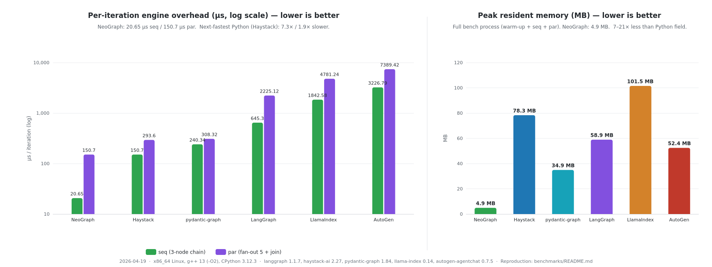

<!-- neograph-i18n: source=benchmarks/README.md locale=ko source_sha256=61dca2e9fea1622aab44c9e328f218beb7526122070c1e692258971eedaf5b6b -->
# NeoGraph와 Python 그래프/파이프라인 프레임워크 비교 — 엔진 오버헤드 벤치마크

**Languages:** [English](README.md) | [한국어](README.ko.md) | [日本語](README.ja.md) | [简体中文](README.zh-CN.md)

I/O, sleep, 모델 호출이 없는 동일한 소규모 워크로드로 NeoGraph와 Python 오케스트레이션 프레임워크의
호출당 엔진 오버헤드를 비교 측정합니다.
측정 범위에는 노드 디스패치, 상태 채널 쓰기, 리듀서 호출이 들어갑니다.
날짜가 붙은 표에는 당시의 엔진 이름과 의존성 버전이 그대로 남아 있습니다.
이 표는 현재 패키지 버전을 나타내지 않습니다.
현재 NeoGraph `0.14.1` 레시피는 alpha SDK `0.3.2`과, 인터페이스 리비전·공유 세대(generation) 6에 맞는
헤더와 라이브러리를 요구합니다.

Program 승인(admission), JavaScript 제어, SQLite/PostgreSQL 런타임 비용은
[Program 비용 측정](../docs/PROGRAM_COST_MEASUREMENT.md)을 참고하세요. 그 문서의 측정 매트릭스는
저널과 체크포인트 작업을 포함하므로, 아래의 체크포인트 없는 Core 비교 결과로 제시해서는 안 됩니다.

비교한 프레임워크는 다음과 같습니다.

| 프레임워크 | 버전 | 추상화 방식 |
|-----------|---------|-------------|
| NeoGraph | 3.0 | 상태 채널 그래프, C++20 코루틴 + asio |
| LangGraph | 1.1.9 | 상태 채널 그래프 (Python) |
| Haystack | 2.27 | 타입이 지정된 소켓을 가진 컴포넌트 파이프라인 |
| pydantic-graph | 1.84 | 다음 노드가 하나뿐인 상태 머신 |
| LlamaIndex Workflow | 0.14 | 이벤트 기반 비동기 워크플로 |
| AutoGen GraphFlow | 0.7.5 | 메시지 전달 방식의 멀티 에이전트 그래프 |

## 워크로드

여섯 구현체는 같은 워크로드 두 가지를 각자 포팅한 것이며, 컴파일이 필요한 경우 한 번만 컴파일한 뒤
반복 루프에서 호출합니다. 상태와 토폴로지를 바꾼 부분은 아래에 적었습니다.

| Id | 형태 | 상태 |
|----|-------|-------|
| `seq` | 노드 3개짜리 체인 `a → b → c` | `counter` 채널 하나를 쓰며, 각 노드가 `counter+1`을 쓴다(overwrite 리듀서). |
| `par` | worker 5개로 fan-out한 뒤 `summarizer`에서 합류 | `results: list`(append 리듀서)와 `count: int`를 쓴다. worker는 각자 자기 인덱스를 append하고, summarizer는 `len(results)`를 쓴다. |

모든 프레임워크에서 체크포인트는 꺼 두었습니다.

세 구현체는 프레임워크에 맞게 워크로드를 조정해야 했습니다.

* **Haystack**에는 append 리듀서가 없습니다. 그래서 worker가 각자 타입이 지정된 소켓으로 출력하고,
  summarizer가 리스트 길이를 합산합니다. 실행 한 번에 디스패치되는 컴포넌트 수는 같습니다.
* **pydantic-graph**는 다음 노드가 하나뿐인 상태 머신이라 fan-out을 할 수 없습니다.
  `par` 워크로드는 노드 6개를 직렬로 이은 체인(`w1 → w2 → w3 → w4 → w5 → summ`)으로 흉내 냈습니다.
  결과 표에 이를 표시했으며, 병렬 fan-out을 동일 조건에서 비교한 측정이 아닙니다.
* **AutoGen**은 상태 채널이 아니라 메시지 전달 방식입니다. 카운터는 텍스트 메시지 내용으로 인코딩하고,
  summarizer는 들어온 worker 메시지의 수를 셉니다. 그래프 모양은 같지만 상태 모델은 다릅니다.

## 결과

아래 **기준 측정(reference run)**은 2026-04-22에 x86_64 Linux에서 NeoGraph v3.0.0을
g++ 13 Release(`-O3 -DNDEBUG`)로 빌드하고 CPython 3.12.3으로 측정한 결과입니다.
NeoGraph는 `bench_neograph` 10회 실행의 중앙값이고, Python 프레임워크는 프레임워크마다 3회 실행의 중앙값입니다.
버전은 neograph v3.0.0, langgraph 1.1.9, haystack-ai 2.28.0, pydantic-graph 1.85.1,
llama-index-core 0.14.21, autogen-agentchat 0.7.5입니다.

기준 측정 아래에는 당시 master(2026-04-29)를 다시 측정한 결과도 함께 실었습니다.
`par` 행에는 지원하는 두 실행 방식을 각각 적었습니다. 하나는 현재 기본값인 `worker_count=1`이고,
다른 하나는 `set_worker_count_auto()`로 켠 엔진 소유 풀입니다.
I/O가 없는 마이크로벤치마크에서 두 수치를 따로 보아야 하는 이유는 표 뒤의 *참고*에 있습니다.



### 반복당 오버헤드 (µs, 낮을수록 좋음)

| 프레임워크 | `seq` (노드 3개 체인) | `par` (fan-out 5 + join) | `seq` NeoGraph 대비 | `par` NeoGraph 대비 |
|-----------|---------------------:|-------------------------:|-------------------:|-------------------:|
| **NeoGraph v3.0.0** *(기준, 2026-04-22)* | **5.0** | **11.8** | 1× | 1× |
| **NeoGraph master** *(2026-04-29, 기본값 `worker_count=1`)* | **5.25** | **14.4** | 1× | 1× |
| **NeoGraph master** *(2026-04-29, `set_worker_count_auto()`)* | **5.25** | **278** | 1× | 1× |
| Haystack 2.28.0 | 139.85 | 278.48 | 28.0× / 26.6× / 26.6× | 23.6× / 19.3× / 1.0× |
| pydantic-graph 1.87.0 | 227.14 | 280.26¹ | 45.4× / 43.3× / 43.3× | 23.7×¹ / 19.5×¹ / 1.0×¹ |
| LangGraph 1.1.10 | 642.62 | 2,261.55 | 128.5× / 122.4× / 122.4× | 191.7× / 157.1× / 8.1× |
| LlamaIndex Workflow 0.14.21 | 1,564.54 | 4,373.76 | 312.9× / 298.0× / 298.0× | 370.7× / 303.7× / 15.7× |
| AutoGen GraphFlow 0.7.5 | 3,126.86 | 7,281.08 | 625.4× / 595.6× / 595.6× | 617.0× / 505.6× / 26.2× |

오른쪽 두 열에는 비율이 세 개씩 있습니다. 순서대로 v3.0.0 기준 측정 대비 / master worker=1 기본값 대비 /
master 자동 worker 모드 대비입니다.

날짜가 다른 `seq` 측정값은 비슷합니다. NeoGraph는 5.0µs에서 5.25µs로 바뀌었습니다.
`par` 측정값은 실행 방식에 따라 11.8µs, 14.4µs, 278µs로 달라집니다.
이 측정들은 기준 측정의 모든 행을 ±10% 안에서 재현하지 못하며, 현재 HEAD를 측정한 것도 아닙니다.

¹ pydantic-graph의 `par`는 노드 6개를 직렬로 이은 흉내이며 fan-out을 지원하지 않습니다.
병렬 워크로드가 아니고, 빠짐없이 싣기 위해 포함했습니다.

### `par` 행에 대한 참고 (`seq`는 그대로)

`par`가 14.4µs에서 278µs로 늘어난 차이는, 실제 일을 하지 않는 노드 다섯 개에 엔진 소유 스레드 풀을 켰을 때
측정된 비용입니다.

* **현재 `build()` / `compile()`의 기본값은 `worker_count=1`입니다.** 엔진 소유 풀을 만들지 않으므로
  fan-out은 호출자의 executor에서 디스패치됩니다. 14.4µs 행이 이 경우입니다. CPU 부담이 작은 노드나
  스레드 안전하지 않은 상태를 가진 노드로 이루어진 그래프에서는 이 행이 회귀를 판단하는 올바른 기준입니다.
* **병렬 fan-out은 명시적으로 켭니다.** `set_worker_count_auto()`는 풀 크기를 `hardware_concurrency`에 맞추고,
  `set_worker_count(N)`은 고정된 상한을 정합니다. 278µs 행이 이 경우입니다. 여기서는 worker가 정수 하나를
  append할 뿐이라 조율 비용이 그대로 드러납니다. 하지만 100ms짜리 LLM 호출에 비하면 무시할 수 있고,
  서로 독립인 노드가 겹쳐 실행될 수 있습니다.

벤치마크 소스를 바꾸지 않고 두 방식을 모두 실행할 수 있습니다.

```bash
./build/bench_neograph 10000 5000 1
./build/bench_neograph 10000 5000 auto
```

세 번째 인자는 `par` 엔진에 적용되며 `1`(기본값), `auto`, 양의 정수인 worker 수를 받습니다.
출력에 `config\tpar_workers\t...` 행이 포함되므로 저장한 결과에도 실행 방식이 남습니다.

날짜가 있는 worker=1 `par` 비교에서 LangGraph의 2,261.55µs는 NeoGraph의 14.4µs의 157.1배입니다.
엔진 소유 풀을 쓰면 이 비율은 8.1배입니다. Haystack과 pydantic-graph는 NeoGraph의 278µs 자동 worker 행과
거의 같습니다. 이 비율은 이 워크로드와 설정에만 해당합니다.

### 프로세스 전체 지표

워밍업과 두 워크로드를 모두 포함한 바이너리/스크립트 전체 실행 시간입니다.
`seq`는 10,000회, `par`는 5,000회 반복했고, `/usr/bin/time -f "%e s, %M KB"`로 측정했습니다.

| 프레임워크 | 전체 소요 시간 | 최대 RSS | Executor |
|-----------|--------------:|---------:|---------:|
| **NeoGraph 3.0** | **0.11 s** | **4.5 MB** | 기본값은 단일 스레드 io_context |
| pydantic-graph | 3.98 s | 35.1 MB | 단일 스레드 asyncio (GIL) |
| Haystack | 3.85 s | 80.3 MB | 단일 스레드 asyncio (GIL) |
| LangGraph | 18.95 s | 60.1 MB | 단일 스레드 asyncio (GIL) |
| LlamaIndex Workflow | 39.49 s | 101.4 MB | 단일 스레드 asyncio (GIL) |
| AutoGen GraphFlow | 63.29 s | 52.3 MB | 단일 스레드 asyncio (GIL) |

NeoGraph 3.0의 기본 슈퍼스텝 루프는 `run_sync`로 단일 스레드 io_context에서 코루틴을 실행합니다.
CPU 병렬 fan-out은 `engine->set_worker_count(N)`으로 직접 켜야 합니다.
I/O 위주의 노드라면 스레드가 하나여도 co_await로 중단되는 동안 다른 작업이 겹쳐 실행됩니다.

## Linux ARM64 기준 측정: Neoverse-N1

이 측정은 [#165](https://github.com/fox1245/NeoGraph/issues/165)에서 나온 별도의 네이티브 ARM64 플랫폼 기준 측정이며,
위 x86_64 표와 비교하는 회귀 측정이 아닙니다. 이후 측정의 출처를 추적할 수 있도록
리비전 `d7a6477`과 이 측정 전용 의존성 집합에 고정했습니다.

| 항목 | 값 |
|---|---|
| 날짜 | 2026-07-22 |
| OS | Ubuntu 24.04, Linux `6.17.0-1018-oracle` |
| 아키텍처 | `aarch64` |
| CPU | vCPU 4개, ARM Neoverse-N1 |
| 메모리 | 23 GiB, 스왑 없음 |
| 컴파일러 / CMake | GCC 13.3.0 / CMake 3.28.3 |
| Python | CPython 3.12.3 |
| NeoGraph 리비전 | `d7a6477` |

워크로드와 반복 횟수는 주 벤치마크와 같습니다. 그래프를 한 번 컴파일한 뒤 `seq`를 10,000회,
`par`를 5,000회 반복했습니다. NeoGraph는 10회, Python 구현은 각각 3회 측정했고 표에는 중앙값을 실었습니다.
체크포인트, 네트워크 I/O, 모델 호출, sleep은 모두 껐습니다. 프로세스 전체의 최대 RSS는
`/usr/bin/time -f "%e s, %M KB"`로 얻었습니다.

| 프레임워크 | `seq` (µs/회) | `par` (µs/회) | `seq` NeoGraph 대비 | `par` NeoGraph 대비 | 최대 RSS |
|---|---:|---:|---:|---:|---:|
| **NeoGraph** | **9.50** | **21.80** | 1× | 1× | **4.35 MB** |
| Haystack 3.0.0 | 153.44 | 329.67 | 16.2× | 15.1× | 73.6 MB |
| pydantic-graph 1.87.0 | 342.60 | 405.87¹ | 36.1× | 18.6×¹ | 32.1 MB |
| LangGraph 1.2.9 | 1,037.55 | 3,289.22 | 109.2× | 150.9× | 63.7 MB |
| LlamaIndex 0.14.23 | 2,765.04 | 7,824.85 | 291.1× | 358.9× | 96.9 MB |
| AutoGen 0.7.5 | 4,166.39 | 9,571.11 | 438.6× | 439.0× | 47.8 MB |

NeoGraph는 worker=1 기본값을 썼으므로, `par` 행은 엔진 소유 스레드 풀의 실행이 아니라 토폴로지, 리듀서,
직렬 디스패치의 오버헤드를 측정한 것입니다. 병렬 fan-out은 `auto` 벤치마크 모드로 따로 측정해야 하며,
두 모드를 하나의 대표 수치로 합쳐서는 안 됩니다.

¹ pydantic-graph는 이 fan-out 토폴로지를 표현할 수 없어서, `par` 행은 위에서 설명한 것과 같은
6노드 직렬 흉내입니다. 당시 최신이던 2.15.0의 API는 벤치마크가 쓰는 `Graph(...)` 생성자를 더 이상
지원하지 않아 1.87.0 버전에 고정했습니다. 프로세스는 CPU에 고정하지 않았고 cgroup으로 제한하지도 않았습니다.

## 수치가 말해 주는 것

1. x86_64 기준 측정의 `seq` 행에서 호출당 오버헤드는 Haystack이 NeoGraph의 28.0배, AutoGen이 625.4배입니다.
   이는 프레임워크와 워크로드를 함께 측정한 값이며, 각 비용의 원인을 따로 설명하지는 않습니다.
2. 기준 측정에서 프로세스 전체의 최대 RSS는 NeoGraph가 4.5MB, Python 구현이 35.1–101.4MB입니다.
   이 값에는 각 프로세스의 런타임과 import가 포함되어 있으며, 실제로 배포한 애플리케이션의 메모리 사용량이 아닙니다.
3. worker=1 디스패치와 엔진 소유 스레드 풀은 서로 다른 실행 방식입니다. 대상 워크로드에서 두 가지를 모두
   측정해야 합니다. 일을 하지 않는 노드로 fan-out하는 벤치마크는 조율 비용을 드러내지만,
   모델이나 I/O 지연을 예측해 주지는 않습니다.

## 주의 사항 — 이 벤치마크가 측정하지 않는 것

* **실제 에이전트 워크로드.** 프레임워크 비교에는 모델 추론, 네트워크 요청, 도구 I/O가 없습니다.
  실제 애플리케이션에서는 이 비용이 지배적일 수 있으므로, 이 표로 에이전트의 엔드투엔드 속도 향상을
  입증할 수는 없습니다.
* **프레임워크에 맞는 워크로드.** AutoGen, LlamaIndex, pydantic-graph는 각각 멀티 에이전트 채팅,
  이벤트 기반의 장시간 워크플로, 상태 머신 제어 흐름이라는 서로 다른 패러다임에 맞춰 최적화되어 있고,
  이 벤치마크는 그 영역을 다루지 않습니다. 말하자면 NeoGraph에 가장 유리한 조건에서 이들을 측정합니다.
* **체크포인트 처리량.** 각 프레임워크에서 영속화를 켜면 직렬화 비용이 결과를 지배하게 됩니다.
  체크포인트 처리량은 별도의 벤치마크가 필요한 주제입니다.
* **콜드 스타트.** 각 구현은 측정 전에 10회 반복하는 워밍업 루프를 포함합니다. 프로세스 전체 수치에는
  Python 인터프리터 부팅(약 200ms)과 프레임워크 import 시간이 들어가며, 이 시간은 프레임워크마다 크게 다릅니다
  (LlamaIndex와 AutoGen은 import하는 모듈 트리가 큽니다).
* **공정성.** NeoGraph는 CMake `-DCMAKE_BUILD_TYPE=Release`로 빌드했고, GCC에서는 `-O3 -DNDEBUG`로 해석됩니다.
  Python 프레임워크는 모두 기본 CPython 3.12에 각 코호트에 기록한 의존성 버전을 쓰며 별도 튜닝을 하지 않았습니다.
  단독 벤치마크 명령은 `-O2`를 썼고, CMake 빌드에서는 `Release`가 `-O3`로 해석됩니다.

## 재현 방법

현재 소스를 빌드하려면 Core 전용 벤치마크도 외부 `SchemaProvider::runtime` 패키지가 필요합니다.
CMake 3.20 이상에서는 명시한 `NEOGRAPH_SCHEMAPROVIDER_SOURCE_DIR`을 먼저 쓰고, 없으면 설치된 런타임을,
그것도 없으면 고정된 공개 GitHub 소스 아카이브를 선택합니다.
`NEOGRAPH_FETCH_SCHEMAPROVIDER`의 기본값은 ON입니다. 설치된 패키지나 명시한 소스로 오프라인 빌드하려면
OFF로 설정합니다.
아래 재현 명령은 현재 유지보수하는 타깃을 빌드하며, 과거의 바이너리를 다시 만들지도, 표에 나온 Python 버전을
자동으로 고정하지도 않습니다.
직접 지정한 체크아웃이나 설치된 패키지는 인터페이스·공유 세대가 6이어야 합니다.
새 결과는 따로 저장해야 합니다. 과거의 표와 JSON 파일은 SDK 0.3.2으로 측정한 결과가 아닙니다.

```bash
# Build native Core + v1 Program benchmarks (Release is required for
# representative timings; the default CMake build type is not optimized).
cmake -B build-program-bench -DCMAKE_BUILD_TYPE=Release \
    -DNEOGRAPH_BUILD_BENCHMARKS=ON \
    -DNEOGRAPH_BUILD_PROGRAM=ON \
    -DNEOGRAPH_BUILD_ASYNC=ON
cmake --build build-program-bench --target \
    bench_neograph bench_program bench_program_dispatch \
    bench_program_serialization_poc bench_program_binary_poc -j

# Positional arguments are iterations, warmup runs, and measured samples.
# bench_neograph additionally accepts par_workers before warmup/samples.
# bench_program's optional fourth argument measures closed-batch outer-run concurrency.
# Its burst rows are throughput-equivalent time, not individual request latency.
./build-program-bench/bench_neograph 10000 5000 1 10 5
./build-program-bench/bench_neograph 10000 5000 auto 10 5
./build-program-bench/bench_program 1000 10 5
./build-program-bench/bench_program 1000 10 5 8
./build-program-bench/bench_program_dispatch 100000 10 5
./build-program-bench/bench_program_serialization_poc 25 100
./build-program-bench/bench_program_binary_poc 25 100

# Build the opt-in protobuf/Cap'n Proto transport-envelope experiment.
# This target alone requires protoc/libprotobuf and capnp/libcapnp.
cmake -S . -B build-program-codec-poc -DCMAKE_BUILD_TYPE=Release \
    -DNEOGRAPH_BUILD_BENCHMARKS=ON \
    -DNEOGRAPH_BUILD_PROGRAM=ON \
    -DNEOGRAPH_BUILD_PROGRAM_CODEC_POC=ON
cmake --build build-program-codec-poc --target bench_program_codec_poc -j
taskset -c 0 ./build-program-codec-poc/bench_program_codec_poc 25 100
```

네이티브 벤치마크는 각각 `config`, `runtime`, `header`, `result` 레코드를 출력합니다.
명시한 워밍업 이후에 측정한 샘플의 중앙값을 보고하고, 짧은 실행 한 번만으로 비교해서는 안 됩니다.
`bench_program`은 인메모리 저장소를 쓰며 provider나 네트워크 호출이 없습니다.
`bench_program_dispatch`는 변경할 수 없는 `ProgramPlan` 조회와 descriptor 순회만 측정하며, Core 실행은 측정하지 않습니다.

직렬화 POC는 오프라인 인메모리 측정입니다. 완료된 Program 실행에서 변경할 수 없는 publication을 가져와 사용합니다.
serialization POC는 정규(canonical) 바이트를 재사용하는 비용을 측정하고, binary POC는 현재의 정규 JSON 봉투(envelope)와
중첩된 레코드마다 정규 바이트를 보존하는 길이 접두 봉투를 비교합니다.
binary 결과는 하한(lower bound)을 확인하는 실험이며, 영속화 계약을 대체하려는 것이 아닙니다.

`bench_program_codec_poc`는 별도로 켜야 하는 항목이며, 같은 중첩 정규 바이트를 두고 protobuf와 Cap'n Proto의
**전송 봉투(transport envelope)**를 비교합니다.
`*_envelope_only_*`는 정규 바이트가 이미 준비된 상태에서 봉투를 만드는 비용만 측정합니다.
`*_transport_total_lower_bound_*`는 중첩 정규 바이트를 만드는 비용까지 포함하지만,
`ProgramTransitionPublication`의 바깥쪽 레코드 간 검증은 일부러 건너뜁니다.
영속화나 식별자 형식을 평가하는 벤치마크가 아닙니다.
복구(recovery) 지표는 파싱해서 소유권을 가진 Program 레코드로 되돌리는 시간까지 포함하며,
수신 측 소비자 전체를 모델링하는 유일한 코덱 수치입니다.
이 POC들은 SQLite/Postgres 트랜잭션 지연이나 `ProgramRuntime`의 엔드투엔드 지연을 측정하지 않습니다.

Python 프레임워크 비교는 선택 사항이며, 서드파티 패키지가 필요합니다.

```bash
# Shared Python venv for every Python framework:
python3 -m venv /tmp/bench_venv
/tmp/bench_venv/bin/pip install \
    langgraph \
    haystack-ai \
    pydantic-graph \
    llama-index-core \
    "autogen-agentchat" "autogen-core" "autogen-ext"

# Run each bench (10k seq + 5k par matches the C++ side):
/tmp/bench_venv/bin/python benchmarks/bench_langgraph.py      10000 5000
/tmp/bench_venv/bin/python benchmarks/bench_haystack.py       10000 5000
/tmp/bench_venv/bin/python benchmarks/bench_pydantic_graph.py 10000 5000
/tmp/bench_venv/bin/python benchmarks/bench_llamaindex.py     10000 5000
/tmp/bench_venv/bin/python benchmarks/bench_autogen.py        10000 5000

# Peak RSS + wall time:
/usr/bin/time -f "%e s, %M KB" ./build-program-bench/bench_neograph
```

서비스를 쓰는 체크포인트, HTTP, 동시성 Docker 벤치마크는 별도의 실험입니다.
위에서 설명한 결정적(deterministic) 네이티브 Core/Program 실행에는 필요하지 않습니다.

출력 형식은 탭으로 구분한 `config`, `runtime`, `header`, `result`, `metric` 레코드입니다.
네이티브 result 행에는 전체 시간의 중앙값과 반복당 시간이 들어 있습니다.
Python 스크립트는 예전 형식 그대로 `workload<TAB>iters<TAB>total_ms<TAB>per_iter_us` 행을 출력합니다.

## 2026-04-19 수치를 측정한 환경

```
OS:        Linux 6.6.87.2-microsoft-standard-WSL2 (Ubuntu 24.04 userland)
CPU:       host CPU (8 logical cores exposed to WSL)
Compiler:  g++ 13.x, -std=c++20 -O2 -DNDEBUG
Python:    3.12.3 (system)
Versions:  langgraph 1.1.7, haystack-ai 2.27.0, pydantic-graph 1.84.1,
           llama-index-core 0.14.20, autogen-agentchat 0.7.5
```

하드웨어, 런타임 버전, 워크로드 형태, worker 모드에 따라 지연 시간과 비율이 모두 달라질 수 있습니다.
이 문서는 플랫폼 사이에 허용되는 오차 범위를 정하지 않습니다.

## Typed provider 전환: 실제 GraphEngine의 전후 비교

아래의 전환(cutover), 최종 검증, handoff 측정은 SDK 인터페이스·공유 세대 3으로 기록했습니다.
이 기록 안의 “current”와 “final”은 각 코호트가 만들어진 시점을 가리키며, 현재 릴리스를 뜻하지 않습니다.

이 절의 내용은 **로컬 TLS HTTP/SSE** 측정으로, 위의 체크포인트 없는 Python 프레임워크 벤치마크와는 별개이며
모델 추론도 아닙니다. 운영(production)용 `GraphEngine.llm_call/tool_dispatch`를 거쳐
정적 Release GCC 13.3 Linux x64 빌드에서 **16개 구성 × 새 프로세스 3회 = 48개 기록**을 측정했습니다.
공통 H1 워크로드 3개, 다섯 계열 전체의 버퍼링/SSE 네이티브 이어가기(continuation), H2 사례 3개를 포함합니다.
유료 API는 호출하지 않았습니다.

[원본 9개 기록](provider-cutover-legacy-results.json)은 수정하지 않은 `7b47ad43`에서 얻었습니다.
[현재 원시 기록](provider-cutover-current-results.json)과 [스칼라 비교](provider-cutover-summary.json)에는
실제 적용된 제어값, 분포, RSS와 스레드 수, 실제 peer 카운터, 소유 결과(owned outcome)가 남아 있습니다.

| 공통 그래프 워크로드 | 전 p50 ms | 후 p50 ms | 전 그래프 실행/s | 후 그래프 실행/s | 전 최대 RSS MiB | 후 최대 RSS MiB |
|---|---:|---:|---:|---:|---:|---:|
| H1 버퍼링 텍스트 | 0.707 | 1.320 | 1,375.58 | 733.65 | 12.617 | 15.465 |
| H1 버퍼링 도구 루프 | 29.337 | 30.510 | 800.30 | 702.64 | 17.832 | 20.219 |
| H1 SSE 도구 루프 | 600.540 | 37.593 | 51.43 | 615.38 | 14.414 | 20.367 |

값은 3회 반복의 중앙값이며, HTTP 요청이 아니라 **그래프 실행 한 번당** 값입니다.
텍스트는 동시성 1에 peer 지연이 없고, 도구 루프는 동시성 32에 요청당 5ms 지연을 두며 그래프 실행 한 번에
생성 요청이 두 번 들어갑니다. 모든 코호트는 10회 워밍업 후 100회를 측정하고,
도구/네이티브 코호트는 반복마다 취소도 8회 요청합니다.

현재 코호트 전체에서 측정 중 실패한 실행은 없었습니다.

절충점(tradeoff)이 있습니다. 소유하는 원시/네이티브/nullable 결과 전체와 authority 게이트가 추가되어 텍스트 지연과
메모리가 늘고, 버퍼링 도구 루프의 p50도 약간 늘어납니다. 반면 SSE는 더 이상 예전 버퍼링 경로의 지연을 겪지 않습니다.
예전 구현은 네이티브/nullable authority와 일부 worker 설정을 지원하지 않았으므로, 이 수치는 같은 워크로드에서 측정한
값일 뿐 의미나 자원 사용이 동등하다는 뜻도, 모델이 빨라진다는 약속도 아닙니다.
현재 p95/p99, 첫 의미 이벤트, 취소 정착(settle) 시간, 확장 계열 행은 JSON 요약에 있습니다.

```sh
cmake -S . -B build-provider-bench -DCMAKE_BUILD_TYPE=Release \
  -DBUILD_SHARED_LIBS=OFF -DNEOGRAPH_ENABLE_NATIVE_OPTIMIZATION=OFF \
  -DNEOGRAPH_BUILD_TESTS=OFF -DNEOGRAPH_BUILD_EXAMPLES=OFF \
  -DNEOGRAPH_BUILD_PROGRAM=OFF -DNEOGRAPH_BUILD_BENCHMARKS=ON \
  -DNEOGRAPH_SCHEMAPROVIDER_SOURCE_DIR="$SCHEMAPROVIDER_SOURCE_DIR" \
  -DSP_BUILD_TESTS=OFF -DSP_BUILD_BENCHMARKS=OFF
cmake --build build-provider-bench --target neograph_provider_cutover_benchmark
for config in benchmarks/provider_cutover_h1_*.json benchmarks/provider_cutover_extended_*.json; do
  build-provider-bench/neograph_provider_cutover_benchmark --config "$config" || exit "$?"
done
```

NeoGraph 루트에서 Node.js, OpenSSL CLI, SDK의 일반 의존성이 있는 환경에서 실행합니다.
peer는 임시 사설 CA를 쓰며, 시스템 신뢰 저장소나 의존성 라이브러리는 바꾸지 않습니다.


## 최종 검증 코호트: 새 typed provider GraphEngine 측정

같은 GraphEngine과 로컬 TLS HTTP/SSE 구성으로 나중에 다시 실행한 Release 코호트는
**16개 구성 × 새 프로세스 3회 반복 = 48개 기록을 실패 없이 38.29초에 마쳤습니다.**
유료 모델은 호출하지 않았습니다. 이 코호트는 위의 과거 표를 대체하지 않습니다.
[최종 스칼라 요약](provider-cutover-final-summary.json)과 [최종 원시 소유 합성 객체](provider-cutover-final-results.json)는
[레거시 9개 기록 코호트](provider-cutover-legacy-results.json),
[이전의 현재 48개 기록 코호트](provider-cutover-current-results.json), [이전 비교](provider-cutover-summary.json)와
별개의 파일입니다. 약 60MB인 원시 파일에는 실제 합성 결과 객체가 들어 있으며 provider 비밀 값은 없습니다.

아래 값은 요약에 실린, 독립 프로세스 3회 반복의 중앙값이며 모델 토큰이나 HTTP 요청이 아니라
**그래프 실행 한 번당** 값입니다. 자원·제어 방식과 네이티브/nullable authority의 차이는 그대로 남아 있습니다.
즉 **의미와 자원 사용이 동등하다는 주장은 성립하지 않습니다.**
이 값은 로컬에서 측정한 절충점일 뿐 모델이 빨라진다는 뜻은 아닙니다.

### 최종 16개 구성 측정값

| 계열 | HTTP | 워크로드 | p50 ms | p95 ms | p99 ms | 그래프 실행/s | 최대 RSS MiB | 최대 스레드 |
|---|---|---|---:|---:|---:|---:|---:|---:|
| `openai.chat` | H1 | 텍스트 버퍼링 | 1.296943 | 1.349401 | 1.397812 | 769.975584 | 15.898438 | 3 |
| `openai.chat` | H1 | 도구 버퍼링 | 30.672507 | 100.492667 | 112.663949 | 678.507993 | 20.585938 | 19 |
| `openai.chat` | H1 | 도구 SSE | 35.800113 | 105.431034 | 117.559931 | 627.047345 | 21.042969 | 19 |
| `openai.chat` | H1 | 네이티브 버퍼링 | 32.546693 | 102.680190 | 115.244483 | 683.637830 | 20.925781 | 19 |
| `openai.chat` | H1 | 네이티브 SSE | 38.135188 | 115.463732 | 126.668501 | 615.357297 | 21.902344 | 19 |
| `anthropic.messages` | H1 | 네이티브 버퍼링 | 30.612805 | 103.979300 | 123.110448 | 678.785191 | 20.324219 | 19 |
| `anthropic.messages` | H1 | 네이티브 SSE | 44.021986 | 71.548005 | 93.941146 | 604.744184 | 22.125000 | 19 |
| `openai.responses` | H1 | 네이티브 버퍼링 | 35.070430 | 100.615954 | 114.597387 | 647.751880 | 22.179688 | 19 |
| `openai.responses` | H1 | 네이티브 SSE | 46.670934 | 77.636952 | 89.664406 | 571.458359 | 25.511719 | 19 |
| `google.generate` | H1 | 네이티브 버퍼링 | 31.449930 | 99.319459 | 112.385528 | 698.783682 | 21.726562 | 19 |
| `google.generate` | H1 | 네이티브 SSE | 37.774704 | 105.703383 | 120.826886 | 627.040287 | 22.500000 | 19 |
| `google.interactions` | H1 | 네이티브 버퍼링 | 32.588486 | 101.365734 | 109.841457 | 690.967042 | 21.664062 | 19 |
| `google.interactions` | H1 | 네이티브 SSE | 46.786625 | 76.036675 | 92.590316 | 573.469300 | 23.058594 | 19 |
| `openai.chat` | H2 | 텍스트 버퍼링 | 1.311873 | 2.443117 | 2.604176 | 701.785481 | 16.148438 | 3 |
| `openai.chat` | H2 | 도구 SSE | 40.349311 | 54.813608 | 59.912728 | 714.064349 | 20.386719 | 19 |
| `google.interactions` | H2 | 네이티브 SSE | 44.561127 | 56.692743 | 64.665852 | 663.966743 | 22.750000 | 19 |

### 공통 H1 워크로드 3개: 수정하지 않은 레거시와 최종 코호트 비교

| H1 그래프 워크로드 | 전 p50 ms | 최종 p50 ms | 전 그래프 실행/s | 최종 그래프 실행/s |
|---|---:|---:|---:|---:|
| 텍스트 버퍼링 | 0.706631 | 1.296943 | 1375.578826 | 769.975584 |
| 도구 버퍼링 | 29.336983 | 30.672507 | 800.301406 | 678.507993 |
| 도구 SSE | 600.539987 | 35.800113 | 51.429767 | 627.047345 |

전(Before) 값은 원래의 7b47ad43 코호트 그대로입니다. 텍스트는 지연 시간이 늘고 처리량이 줄었으며,
버퍼링 도구 루프의 변화는 크지 않고, SSE는 예전 버퍼링 경로의 지연을 없앴습니다.
확장 계열/프로토콜, 첫 의미 이벤트, 취소, 네이티브 재생(replay), 보관된 결과는 최종 요약과 원시 기록에 있습니다.

## 이벤트 기반 Provider handoff: 동일 조건의 폴링과 병합(coalesced) 채널 비교

[측정 요약](provider-notification-summary.json): 코호트당 8개 구성 × 새 프로세스 3회 = 48개 기록,
측정한 그래프 실행 4800회, 실패 0건.
GCC13.3 Release 정적/하드닝 빌드에 네이티브 최적화는 끈 상태이고, 같은 로컬 TLS 오라클과 승인(admission)된 제어값을 썼으며,
프로세스마다 10회 워밍업 후 100회를 측정했습니다. 동시에 실행한 컴파일 작업이나 모델 추론은 없었습니다.
값은 프로세스별 통계의 중앙값이며 신뢰구간이나 모델 토큰 속도가 아닙니다.
아래 payload 크기는 픽스처 텍스트의 패딩이고, 0이어도 응답 봉투는 253B입니다.

| H1 워크로드 | 전 p50 ms | 후 p50 ms | 전 그래프 실행/s | 후 그래프 실행/s |
|---|---:|---:|---:|---:|
| text256, 동시성 1 | 1.302474 | 0.952992 | 738.901074 | 1022.958838 |
| text0, 동시성 1 | 1.286646 | 0.912571 | 761.940993 | 1070.657541 |
| text4KiB, 동시성 1 | 1.387636 | 1.128831 | 709.024147 | 870.631703 |
| text64KiB, 동시성 1 | 4.873767 | 4.144619 | 196.243991 | 240.268946 |
| text256, peer 지연 5ms | 6.601920 | 6.425313 | 146.906115 | 155.052016 |
| text256, 동시성 32 | 7.641085 | 6.939675 | 1645.559595 | 1803.087419 |
| 도구 버퍼링, 동시성 32 | 30.548201 | 31.348443 | 710.487696 | 692.440963 |
| 도구 SSE, 동시성 32 | 33.597342 | 38.607118 | 655.586834 | 611.740359 |

작은 텍스트의 p50은 26.83% 줄고 처리량은 38.44% 늘었으며, 도구/SSE의 처리량은 각각 2.54%/6.69% 줄었습니다.
‘후’ 쪽은 폴링 대신 용량 1짜리 동시성 채널로 provider 알림을 병합(coalescing)합니다.
계측을 넣은 180회 연산 실행을 따로 측정한 결과, SDK publication에서 drain까지의 p50은 전 383.7125µs에서 후 36.4165µs로 줄었고,
타이머 대기는 298회에서 0회가 되었으며 알림 대기는 180회였습니다.
이 프로브 수치는 운영 지연 시간 표에 포함하지 않았습니다.

자원 최고치는 1ms 간격 샘플링 값입니다. 이 측정은 Linux/POSIX에서만 수행했습니다.
