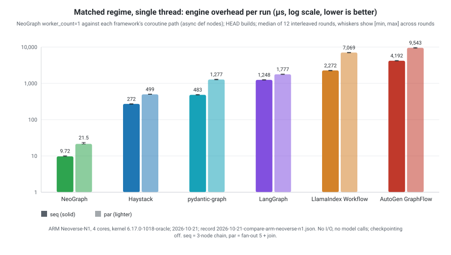

# NeoGraph vs. Python graph/pipeline frameworks — engine-overhead benchmark

**Languages:** [English](README.md) | [한국어](README.ko.md) | [日本語](README.ja.md) | [简体中文](README.zh-CN.md)

Measures the per-run engine overhead of NeoGraph and of five Python orchestration frameworks on two
small workloads with no I/O, sleep, model calls or durable checkpointing, together with the memory, start-up time and
size of each. The measurements include node dispatch, state-channel writes and reducer calls.

Every table and the chart on this page are generated by `scripts/render_bench_report.py` from one checked-in record
(the file that [`records/CURRENT`](records/CURRENT) names). The record holds the raw samples of every cell and the
provenance of the session: commits, compiler and flags, CPU, kernel, package versions, load average and the sha256 of
the scripts. A test fails when a table differs from its record. The earlier tables, measured in separate sessions
with mixed versions, are kept with a note on what is known to be invalid in
[the 2026-04 history](history/engine-overhead-2026-04.md); they are not comparable with the tables here.
Current NeoGraph `0.16.0` recipes require alpha SDK `0.4.0`, interface revision/shared
generation 7, with matching headers and libraries.

For Program admission, JavaScript control, and SQLite/PostgreSQL runtime costs,
see [Measuring Program costs](../docs/PROGRAM_COST_MEASUREMENT.md). That separate
matrix includes journal/checkpoint work and must not be presented as the
checkpoint-free Core comparison below.

## Cohort

NeoGraph and the five frameworks were installed, built and measured in one session on one machine. **HEAD** is the
tip of the framework's default branch, installed from git at the commit shown; **release** is the latest PyPI release
at the time. The release builds run only the matched cells, so that a reader can see whether HEAD and the release
differ. If a HEAD build had failed to install or import, the release would stand in for it and the table would say so.
NeoGraph is the `origin/master` commit shown, built in the default Release configuration, which includes hardening
flags (see [Engine ceiling](#engine-ceiling-and-the-hardening-delta)).

<!-- bench-record:begin cohort -->
| Framework | Latest release | HEAD (commit, date, version) |
| :--- | :--- | :--- |
| LangGraph | langgraph 1.2.16, langchain-core 1.6.12 | langgraph 1.2.16, langchain-core 1.6.12; `langchain@e6d83ef` (2026-10-20), `langgraph@3cd57c0` (2026-10-21) |
| Haystack | haystack-ai 3.4.0 | haystack-ai 3.5.0-rc0; `haystack@276746c` (2026-10-21) |
| pydantic-graph | pydantic-graph 2.59.0 | pydantic-graph 2.59.1.dev4+e0ccafa8a; `pydantic-ai@e0ccafa` (2026-10-21) |
| LlamaIndex Workflow | llama-index-core 0.14.25, llama-index-workflows 2.26.0 | llama-index-core 0.14.25, llama-index-workflows 2.26.0; `llama_index@619d746` (2026-10-14), `workflows-py@f3528e8` (2026-10-21) |
| AutoGen GraphFlow | autogen-agentchat 0.7.5, autogen-core 0.7.5 | autogen-agentchat 0.7.5, autogen-core 0.7.5; `autogen@004749e` (2026-10-16) |

Host: ARM Neoverse-N1, 4 cores, kernel 6.17.0-1018-oracle, Python 3.12.3, NeoGraph built with g++ (Ubuntu 13.3.0-6ubuntu2~24.04.1) 13.3.0; CPU governor: not exposed by the host.

Session: 2026-10-21T13:24:06Z to 2026-10-21T13:59:49Z UTC; 1-minute load average 0.26 when the first phase started (after the wait for an idle host) and 0.97 at the end, which includes the session's own processes; 12 interleaved rounds; record `2026-10-21-compare-arm-neoverse-n1.json`.

NeoGraph engine: commit `db0fc651e2c9`; harness tree: commit `10d6c77a7d42`. The harness commit is the local commit the session ran from and may not exist in this repository's history; the record is never edited, and it holds the sha256 of every harness script, which identifies the files. The files in this tree are byte-identical to the hashed ones except `scripts/render_bench_report.py` (the version that rendered these tables is hashed below) and `port_llamaindex.py` and `port_autogen.py` in `benchmarks/compare/` (one comment each, corrected after the session).

Tables rendered by `scripts/render_bench_report.py` (sha256 `db933a39bedf3733`…).
<!-- bench-record:end cohort -->

## Workloads

Every framework ports the same two workloads. The graph, pipeline or workflow is built once outside the timed
region (an instance is reused wherever the framework allows it), and the timed loop invokes it. State and topology
adaptations are listed below.

| Id | Shape | State |
|----|-------|-------|
| `seq` | 3-node chain `a → b → c` | single `counter` channel, each node writes `counter+1` (overwrite reducer) |
| `par` | fan-out 5 workers then join at `summarizer` | `results: list` (append reducer) + `count: int`; each worker appends its index, summarizer writes `len(results)` |

Every run is checked: the final state must be the expected one (counter 3; five indices and count 5). The check runs
on the last run of every sample and on one extra run after the clock has stopped. A cell with a wrong answer, a failed
run or no completed run is an error cell: no timing is published for it, and the record lists it.

No durable checkpointer is configured on any framework. AutoGen accumulates the message thread of a run, which is a
per-run cost of the framework.

Port notes:

* **Haystack** has no append reducer — each worker emits on its own typed socket and the summarizer sums the list
  lengths. Same number of components dispatched per run. Telemetry is switched off for the benchmark processes.
* **pydantic-graph** now has one API, the `GraphBuilder`: steps are `async def`, an edge to several steps broadcasts,
  and a join waits for them. `par` is a real fan-out: five steps from the start node, joined with `reduce_list_append`,
  then a summarizer step. The `BaseNode` classes shown first in its documentation return exactly one next node, so for
  them `par` is a serial six-node chain; that variant appears only in the idiomatic block.
* **LlamaIndex** joins with `ctx.collect_events`, so the summarizer step function runs once per result event (five
  times; four return `None` while waiting). A `Workflow` instance can be reused across runs and concurrently (see the
  probes), so the matched rows reuse one; the idiomatic row builds a new instance per run.
* **AutoGen** is message-passing, not state-channel. The counter is encoded as text message content, the summarizer
  reports the worker messages it received, and `reset()` runs before every run, as in AutoGen's documentation for a new
  task; it clears the manager's message thread. A repeated run without it also returns the right answer (0.7.5: the graph
  resets its own execution state when it completes) and is not timed here.
* **LangGraph** nodes are `async def` for `ainvoke` and plain `def` for `invoke`; the graphs are otherwise identical.

## Matched regime: the only block with ratios

Two execution regimes are compared, each with its own NeoGraph row:

* **Single thread.** NeoGraph with `worker_count=1` against each framework's coroutine path with `async def` nodes:
  LangGraph `ainvoke`, Haystack `run_async` with coroutine components, pydantic-graph (its only path), LlamaIndex with
  `async def` steps, and AutoGen (its only path). Nodes run on the caller's thread.
* **Thread pool.** NeoGraph with `set_worker_count_auto()` against each framework's thread-pool path where one
  exists and was timed: LangGraph `invoke` (a fan-out step runs on a thread pool that langchain-core creates for every
  call) and Haystack `run_async` with sync-only components (each runs through `asyncio.to_thread`). A framework without
  such a path, or whose path was not timed, has an `n/a` row with the reason; nothing is emulated. LlamaIndex Workflow
  is in the second group: it accepts plain `def` steps and runs them on the event loop's default executor, and that path
  is not in this cohort. The pools keep their default widths (NeoGraph: one thread per hardware thread, 4 here; the
  Python executors: `min(32, cores + 4)`); the [`dr_compare` guide](dr_compare/README.md) matches them. For `seq` every
  step has a single ready node, which NeoGraph and LangGraph `invoke` both run inline, so neither pool is used; the
  LangGraph row is still that framework's default synchronous path.

A ratio divides a framework's median by the median of the NeoGraph row of the same regime and workload. NeoGraph's
`par` depends on its worker mode, and the range is stated under the second table; no single ratio summarises it.

The rows below the table header are the HEAD build and the latest release of the same framework.

### Single thread

<!-- bench-record:begin matched_single -->
| Framework | Source | `seq` µs per run | `par` µs per run | `seq` vs. NeoGraph | `par` vs. NeoGraph |
| :--- | :--- | ---: | ---: | ---: | ---: |
| **NeoGraph `worker_count=1`** |  | **9.72 [9.68, 10.1]** | **21.5 [21.4, 23.6]** | 1× | 1× |
| Haystack — Pipeline.run_async, async components | HEAD `276746c` (3.5.0-rc0) | 272 [266, 275] | 499 [497, 507] | 27.9× | 23.2× |
| Haystack — Pipeline.run_async, async components | release 3.4.0 | 273 [266, 276] | 501 [499, 505] | 28.1× | 23.3× |
| pydantic-graph — GraphBuilder steps, real fan-out | HEAD `e0ccafa` (2.59.1.dev4+e0ccafa8a) | 483 [476, 494] | 1,277 [1,252, 1,308] | 49.7× | 59.3× |
| pydantic-graph — GraphBuilder steps, real fan-out | release 2.59.0 | 487 [480, 501] | 1,271 [1,256, 1,294] | 50.0× | 59.1× |
| LangGraph — ainvoke, async def nodes | HEAD `3cd57c0` (1.2.16) | 1,248 [1,232, 1,273] | 1,777 [1,754, 1,808] | 128× | 82.6× |
| LangGraph — ainvoke, async def nodes | release 1.2.16 | 1,258 [1,242, 1,280] | 1,773 [1,750, 1,792] | 129× | 82.4× |
| LlamaIndex Workflow — one workflow instance reused | HEAD `619d746` (0.14.25) | 2,272 [2,219, 2,297] | 7,069 [6,937, 7,136] | 234× | 329× |
| LlamaIndex Workflow — one workflow instance reused | release 0.14.25 | 2,364 [2,339, 2,396] | 7,393 [7,235, 7,458] | 243× | 344× |
| AutoGen GraphFlow — GraphFlow reset and run | HEAD `004749e` (0.7.5) | 4,192 [4,135, 4,286] | 9,543 [9,346, 9,734] | 431× | 444× |
| AutoGen GraphFlow — GraphFlow reset and run | release 0.7.5 | 4,224 [4,115, 4,274] | 9,521 [9,405, 9,645] | 434× | 443× |

Figures are the median across 12 interleaved rounds with [min, max] across rounds; each round runs every cell once in a shuffled order, one fresh process per cell. Ratios divide medians.
<!-- bench-record:end matched_single -->



### Thread pool

<!-- bench-record:begin matched_pool -->
| Framework | Source | `seq` µs per run | `par` µs per run | `seq` vs. NeoGraph | `par` vs. NeoGraph |
| :--- | :--- | ---: | ---: | ---: | ---: |
| **NeoGraph `set_worker_count_auto()`** |  | **10.2 [10.1, 10.5]** | **86.0 [82.8, 86.9]** | 1× | 1× |
| Haystack — Pipeline.run_async, sync components in threads | HEAD `276746c` (3.5.0-rc0) | 759 [745, 779] | 1,424 [1,389, 1,460] | 74.8× | 16.6× |
| Haystack — Pipeline.run_async, sync components in threads | release 3.4.0 | 757 [738, 780] | 1,426 [1,388, 1,459] | 74.5× | 16.6× |
| pydantic-graph |  | n/a — no thread-pool path: steps are coroutines and a plain function is rejected |  |  |  |
| LangGraph — invoke, def nodes | HEAD `3cd57c0` (1.2.16) | 1,063 [1,049, 1,079] | 3,184 [3,146, 3,224] | 105× | 37.0× |
| LangGraph — invoke, def nodes | release 1.2.16 | 1,066 [1,053, 1,088] | 3,194 [3,163, 3,301] | 105× | 37.1× |
| LlamaIndex Workflow |  | n/a — not timed: plain `def` steps are accepted and run on the event loop's default executor, a thread-pool path that this cohort does not measure |  |  |  |
| AutoGen GraphFlow |  | n/a — no thread-pool path: one single-threaded agent runtime |  |  |  |

NeoGraph `par` is 21.5 µs with `worker_count=1` and 86.0 µs with `set_worker_count_auto()` (4 worker threads).
<!-- bench-record:end matched_pool -->

## Idiomatic default: absolute times, no ratio

The API that each framework's own documentation shows first. These rows do different work from each other (per-run
construction, a thread hop, a serial chain), so only absolute times are given and no ratio is formed.

<!-- bench-record:begin idiomatic -->
| Framework | API measured | `seq` µs per run | `par` µs per run |
| :--- | :--- | ---: | ---: |
| **NeoGraph** | **NeoGraph `run()` (default `worker_count=1`)** | **9.72 [9.68, 10.1]** | **21.5 [21.4, 23.6]** |
| Haystack | Pipeline.run, sync components | 143 [143, 144] | 321 [318, 325] |
| pydantic-graph | GraphBuilder steps, real fan-out | 483 [476, 494] | 1,277 [1,252, 1,308] |
| pydantic-graph | BaseNode classes (par is a serial chain) | 535 [525, 547] | 818 [802, 823] |
| LangGraph | invoke, def nodes | 1,063 [1,049, 1,079] | 3,184 [3,146, 3,224] |
| LlamaIndex Workflow | new workflow instance per run | 2,615 [2,577, 2,656] | 7,536 [7,408, 7,729] |
| AutoGen GraphFlow | GraphFlow reset and run | 4,192 [4,135, 4,286] | 9,543 [9,346, 9,734] |
| AutoGen GraphFlow | new GraphFlow per run | 5,274 [5,239, 5,372] | 11,280 [11,082, 11,549] |
<!-- bench-record:end idiomatic -->

## Engine ceiling and the hardening delta

The NeoGraph rows above are the default Release build, which adds `-D_GLIBCXX_ASSERTIONS`, `-fstack-protector-strong`,
`-D_FORTIFY_SOURCE=2`, position-independent code and RELRO to `-O3 -DNDEBUG`. A second build without them
(`-DNEOGRAPH_ENABLE_HARDENING=OFF`, plus `-U_FORTIFY_SOURCE -fno-stack-protector -fno-stack-clash-protection` because
the distribution's compiler turns those on by default) is the engine ceiling. The flags of both builds, and the
macros each binary was compiled with, are printed under the table.

<!-- bench-record:begin ceiling -->
| Build | `seq`, `worker_count=1` | `par`, `worker_count=1` | `par`, `set_worker_count_auto()` |
| :--- | ---: | ---: | ---: |
| default Release build (hardened) — the headline | 9.72 [9.68, 10.1] | 21.5 [21.4, 23.6] | 86.0 [82.8, 86.9] |
| unhardened engine ceiling | 9.88 [9.86, 10.6] | 20.7 [20.5, 22.2] | 84.6 [81.9, 86.5] |
| hardened ÷ unhardened | 0.98× | 1.04× | 1.02× |

| Build | µs |
| :--- | ---: |
| `seq` with every lifecycle event built and delivered to a callback | 10.7 [10.7, 11.6] |

Flags and compiler macros of the default build, as printed by the binary and the build tree:

```text
[hardened] build type: Release; g++ (Ubuntu 13.3.0-6ubuntu2~24.04.1) 13.3.0
[hardened] NEOGRAPH_ENABLE_HARDENING: ON
[hardened] compile: /usr/bin/c++ -DASIO_NO_DEPRECATED -DASIO_STANDALONE -DNEOGRAPH_BENCH_BUILD_TYPE=\"Release\" -DNEOGRAPH_STATIC_BUILD -I<work>/ng/include -I<work>/ng/deps/yyjson -I<work>/ng/deps/asio/include -I<work>/build-hardened/generated -I<work>/build-hardened/_deps/neograph_schemaprovider-src/src -I<work>/build-hardened/_deps/neograph_schemaprovider-build/generated -O3 -DNDEBUG -std=gnu++20 -fPIE -D_GLIBCXX_ASSERTIONS -fstack-protector-strong -D_FORTIFY_SOURCE=2 -o CMakeFiles/bench_neograph.dir/benchmarks/bench_neograph.cpp.o -c <work>/ng/benchmarks/bench_neograph.cpp
[hardened] macros seen by the binary: _GLIBCXX_ASSERTIONS=True, _FORTIFY_SOURCE=2, stack protector=strong, PIE=True
[unhardened] build type: Release; g++ (Ubuntu 13.3.0-6ubuntu2~24.04.1) 13.3.0
[unhardened] CMAKE_CXX_FLAGS: -U_FORTIFY_SOURCE -fno-stack-protector -fno-stack-clash-protection
[unhardened] NEOGRAPH_ENABLE_HARDENING: OFF
[unhardened] compile: /usr/bin/c++ -DASIO_NO_DEPRECATED -DASIO_STANDALONE -DNEOGRAPH_BENCH_BUILD_TYPE=\"Release\" -DNEOGRAPH_STATIC_BUILD -I<work>/ng/include -I<work>/ng/deps/yyjson -I<work>/ng/deps/asio/include -I<work>/build-unhardened/generated -I<work>/build-unhardened/_deps/neograph_schemaprovider-src/src -I<work>/build-unhardened/_deps/neograph_schemaprovider-build/generated -U_FORTIFY_SOURCE -fno-stack-protector -fno-stack-clash-protection -O3 -DNDEBUG -std=gnu++20 -fPIE -o CMakeFiles/bench_neograph.dir/benchmarks/bench_neograph.cpp.o -c <work>/ng/benchmarks/bench_neograph.cpp
[unhardened] macros seen by the binary: _GLIBCXX_ASSERTIONS=False, _FORTIFY_SOURCE=0, stack protector=none, PIE=True
```
<!-- bench-record:end ceiling -->

## Memory

Every figure is for a whole process and **includes the interpreter and the imported framework** for Python (and the C++
runtime and the SchemaProvider runtime for NeoGraph); it is not the memory of a deployed application.

* **Idle** is the process after the framework is imported (NeoGraph: after the engine is built) and before any run.
  The first two rows are the empty baselines: the Python interpreter with nothing imported, and the NeoGraph binary.
* **Peak** is `VmHWM` at the end of the timed loops of the matched cell; the increase is peak minus idle.
* **Marginal memory per in-flight run** parks N runs inside one node (the middle node of `seq`; the summarizer of `par`,
  after the five workers have written their results) on a single event loop (NeoGraph: one `io_context` thread) and
  reads the process's `VmRSS` and `Pss` at that moment. The figure is the difference between N=64 and N=1 divided by 63,
  after one run has completed and the allocator has been asked to return free memory. AutoGen needs one team per
  in-flight run and builds them inside the measured window; the other frameworks share one compiled graph or workflow
  instance.

<!-- bench-record:begin memory -->
| Framework (HEAD) | Idle: imported, nothing run (MiB) | Peak during `seq` loops (MiB) | Peak during `par` loops (MiB) | Increase over idle, `seq` / `par` (MiB) |
| :--- | ---: | ---: | ---: | ---: |
| Python interpreter alone, nothing imported | 10.9 | — | — | — |
| **NeoGraph**: binary with the engine built, nothing run | 5.3 | 6.1 | 6.2 | 0.8 / 0.9 |
| Haystack | 63.5 | 70.2 | 70.2 | 6.7 / 6.7 |
| pydantic-graph | 25.1 | 26.2 | 26.2 | 1.1 / 1.2 |
| LangGraph | 62.8 | 63.0 | 63.1 | 0.2 / 0.3 |
| LlamaIndex Workflow | 35.5 | 36.7 | 36.7 | 1.1 / 1.2 |
| AutoGen GraphFlow | 42.2 | 42.7 | 42.8 | 0.5 / 0.5 |

**Marginal memory per in-flight run**

| Framework (HEAD) | `seq` KiB per run (RSS / PSS) | `par` KiB per run (RSS / PSS) |
| :--- | ---: | ---: |
| **NeoGraph** | 33.9 / 33.8 | 49.9 / 50.0 |
| Haystack | 14.2 / 14.2 | 27.3 / 27.4 |
| pydantic-graph | 24.3 / 24.4 | 57.8 / 57.7 |
| LangGraph | 37.1 / 37.3 | 93.8 / 93.8 |
| LlamaIndex Workflow | 58.5 / 58.3 | 119.5 / 119.5 |
| AutoGen GraphFlow | 96.4 / 96.3 | 174.1 / 174.1 |
<!-- bench-record:end memory -->

## Start-up and size

**Cold start** is the time from the moment the parent spawns the process to the moment its first `seq` run has completed
and been checked. The parent reads `CLOCK_MONOTONIC` just before it spawns the process; the process prints
`CLOCK_MONOTONIC` when the run is done. It covers the loader or interpreter start, the imports (Python) or static
initialisation (NeoGraph), building the graph and one run, with the page cache warm and bytecode caches present.
Twenty fresh processes per framework, interleaved across frameworks; the figure is the median with [min, max].

**Size.** Native binaries are measured after `strip`; `libneograph_core.a` is an archive of objects as built; the
WebAssembly modules come from the size gate of the WebAssembly workflow; a Python environment is the on-disk size of
`site-packages` in a fresh virtual environment that contains the framework and its whole dependency closure, minus an
empty virtual environment, with the number of packages. A native executable, a WebAssembly module and a Python
environment are **different units of deployment**; the table puts them side by side and forms no ratio between them.

<!-- bench-record:begin footprint -->
| Framework (HEAD) | Process start to first `seq` result, ms | Import / build / first run (median ms) |
| :--- | ---: | ---: |
| **NeoGraph** | **2.49 [2.40, 10.7]** | — / 0.55 / 0.09 |
| Haystack | 561 [550, 583] | 395 / 0.84 / 99.6 |
| pydantic-graph | 153 [149, 157] | 72.0 / 0.56 / 12.8 |
| LangGraph | 756 [735, 775] | 683 / 0.72 / 4.13 |
| LlamaIndex Workflow | 314 [309, 330] | 219 / 22.8 / 4.63 |
| AutoGen GraphFlow | 331 [326, 345] | 257 / 0.73 / 8.05 |

| Item | Unit of deployment | Size | What is counted |
| :--- | :--- | ---: | :--- |
| NeoGraph `bench_footprint` (default hardened Release) | one native executable | 7.15 MB | minimal app: registers a node, compiles `seq`, runs it once; stripped |
| NeoGraph `bench_neograph` (default hardened Release) | one native executable | 7.15 MB | the benchmark binary; stripped |
| NeoGraph `libneograph_core.a` (default hardened Release) | one library file | 25.84 MB | static archive as built |
| NeoGraph `bench_footprint` (MinSizeRel with LTO (`-Os`)) | one native executable | 2.82 MB | minimal app: registers a node, compiles `seq`, runs it once; stripped |
| NeoGraph `bench_footprint` (unhardened Release) | one native executable | 6.49 MB | minimal app: registers a node, compiles `seq`, runs it once; stripped |
| NeoGraph `bench_neograph` (unhardened Release) | one native executable | 6.49 MB | the benchmark binary; stripped |
| NeoGraph `libneograph_core.a` (unhardened Release) | one library file | 23.86 MB | static archive as built |
| NeoGraph `bench_footprint` (shared `libneograph_core.so`) | one native executable | 0.26 MB | executable only; stripped |
| NeoGraph shared deployment of the minimal app | an executable and its shared libraries | 10.44 MB | executable plus 7 NeoGraph and SDK shared libraries; stripped |
| NeoGraph graph smoke `smoke.wasm` (Emscripten 6.0.13, -O3 -flto, Release) | one WebAssembly module | 5.53 MB / 1.61 MB gzip | size gate of the WebAssembly workflow in CI, single-thread job, commit db0fc651 |
| NeoGraph JavaScript module `neograph_module.wasm` (Emscripten 6.0.13, -O3 -flto, Release) | one WebAssembly module | 6.29 MB / 1.84 MB gzip | size gate of the WebAssembly workflow in CI, single-thread job, commit db0fc651 |
| Haystack (HEAD install) | Python environment: the framework and its whole dependency closure | 140.75 MB | 42 packages; site-packages minus an empty venv |
| pydantic-graph (HEAD install) | Python environment: the framework and its whole dependency closure | 12.03 MB | 9 packages; site-packages minus an empty venv |
| LangGraph (HEAD install) | Python environment: the framework and its whole dependency closure | 65.46 MB | 38 packages; site-packages minus an empty venv |
| LlamaIndex Workflow (HEAD install) | Python environment: the framework and its whole dependency closure | 216.19 MB | 62 packages; site-packages minus an empty venv |
| AutoGen GraphFlow (HEAD install) | Python environment: the framework and its whole dependency closure | 36.93 MB | 11 packages; site-packages minus an empty venv |
<!-- bench-record:end footprint -->

## Probes

Questions that decide how a row is read, answered in the same session: (1) can a LlamaIndex workflow instance be
reused across runs; (2) how much of LangGraph's fan-out cost is its per-call thread pool, and which threads do the
Haystack workers run on; (3) is pydantic-graph async-only and is its fan-out real; (4) what does hardening cost the
engine; (5) why did two older harnesses measure the same pydantic-graph call at 227 µs and at 70 to 100 µs.

<!-- bench-record:begin probes -->
| # | Result |
| :--- | :--- |
| 1 | LlamaIndex: one `Workflow` instance runs repeatedly and concurrently — sequential runs [3, 13], concurrent runs [3, 103], llama-index-workflows 2.26.0. |
| 1 | LlamaIndex timed: a reused instance 2,272 µs and a new instance per run 2,615 µs for `seq`; 7,069 µs and 7,536 µs for `par`. |
| 2 | LangGraph: `invoke` runs the five workers on 1 pool thread(s), none of them the calling thread; `ainvoke` with `async def` nodes runs them on the calling thread. Timed: `invoke` 3,184 µs against `ainvoke` 1,777 µs for `par` (1.79×), 1,063 µs against 1,248 µs for `seq` (0.85×). |
| 2 | Haystack: with sync components, `run_async` offloads the workers to 3 thread(s) other than the calling one; with `run_async` components they run on the calling thread, as `run` does. |
| 3 | pydantic-graph 2.59.1.dev4+e0ccafa8a: `Graph.run` is a coroutine and `run_sync` only drives it on the event loop; a plain step function is rejected (TypeError: object int can't be used in 'await' expression); five steps that each wait 50 ms finish in 52 ms on 1 thread(s), so the fan-out is real and single-threaded. |
| 4 | Hardening delta of `bench_neograph`: the default hardened build against the unhardened build, `seq` 0.98×, `par` with `worker_count=1` 1.04×, `par` with the worker pool 1.02×. |
| 5 | pydantic-graph 1.x, legacy `Graph(nodes=[...])` API, measured back to back on this host: a loop of awaited runs 79.3 µs per run, the same runs as gathered tasks 87.2 µs, the loop inside one task 79.2 µs, with the cyclic collector off 79.2 µs. The shape of the harness does not explain the older 227 µs against 70 to 100 µs: the two figures came from different sessions and environments. |
| 5 | The same legacy pydantic-graph loop with the optional `logfire` package installed in the environment: 498 µs per run, 6.3× the clean environment (79.3 µs). Its instrumentation spans are no-ops without the package and real spans with it, so a shared environment that contains it changes the figure. |
<!-- bench-record:end probes -->

## What the numbers mean

1. A ratio is specific to its pair of regimes, its workload, its host and the versions in the cohort table. NeoGraph's
   `par` differs between its two worker modes by the factor stated under the thread-pool table, so no single "N times
   faster" figure describes the engine.
2. The rows are framework/workload measurements, not isolated explanations of their costs. They include what each
   framework does on every run by default (callbacks, spans, state snapshots, message threads).
3. Worker=1 dispatch and an engine-owned thread pool are different execution regimes. Measure both for the intended
   workload; a no-work fan-out benchmark exposes coordination costs but does not predict model or I/O latency.
4. Memory figures include the interpreter and the imported framework. For a deployed Python service the engine's
   share is the increase over idle and the marginal per-run figure, not the whole-process peak.

## Caveats — what this bench does NOT measure

* **Real agent workloads.** No model inference, network request, or tool I/O occurs in the framework comparison. Those
  costs can dominate an application, so the tables do not establish end-to-end agent speedups.
* **Framework-appropriate workloads.** AutoGen, LlamaIndex, and pydantic-graph each optimize for paradigms (multi-agent
  chat, event-driven long-running workflows, state-machine control flow) that this bench does not exercise.
* **Checkpoint throughput.** Enabling persistence on each framework would let serialization cost dominate; that is a
  different benchmark.
* **One host, one session.** The cohort ran on one 4-core Arm machine. Ratios move with the platform and with the
  framework version, and the HEAD and release rows show how far they move with the version alone.
* **Fairness.** NeoGraph is the default Release build with its hardening flags (printed above); the unhardened row
  is the ceiling. Every Python framework is stock CPython 3.12 in its own virtual environment with the dependency
  versions recorded in the record, without custom tuning, so that no package installed for one framework changes
  another's cost.

## Reproduce

Current source builds require the external `SchemaProvider::runtime` package,
including Core-only benchmarks. CMake 3.20+ selects explicit
`NEOGRAPH_SCHEMAPROVIDER_SOURCE_DIR`, then an installed runtime, then the pinned
public GitHub source archive. `NEOGRAPH_FETCH_SCHEMAPROVIDER` defaults to ON;
set it OFF for offline builds using an installed package or explicit source.
An explicit checkout or installed package must provide interface/shared generation 7.
Save new outputs separately; a record under `records/` is never edited after it is written.

```bash
# Build native Core + v1 Program benchmarks (Release is required for
# representative timings; the default CMake build type is not optimized).
cmake -B build-program-bench -DCMAKE_BUILD_TYPE=Release \
    -DNEOGRAPH_BUILD_BENCHMARKS=ON \
    -DNEOGRAPH_BUILD_PROGRAM=ON \
    -DNEOGRAPH_BUILD_ASYNC=ON
cmake --build build-program-bench --target \
    bench_neograph bench_program bench_program_dispatch \
    bench_program_serialization_poc bench_program_binary_poc -j

# Positional arguments are iterations, warmup runs, and measured samples.
# bench_neograph additionally accepts par_workers before warmup/samples.
# bench_program's optional fourth argument measures closed-batch outer-run concurrency.
# Its burst rows are throughput-equivalent time, not individual request latency.
./build-program-bench/bench_neograph 10000 5000 1 10 5
./build-program-bench/bench_neograph 10000 5000 auto 10 5
./build-program-bench/bench_program 1000 10 5
./build-program-bench/bench_program 1000 10 5 8
./build-program-bench/bench_program_dispatch 100000 10 5
./build-program-bench/bench_program_serialization_poc 25 100
./build-program-bench/bench_program_binary_poc 25 100

# Build the opt-in protobuf/Cap'n Proto transport-envelope experiment.
# This target alone requires protoc/libprotobuf and capnp/libcapnp.
cmake -S . -B build-program-codec-poc -DCMAKE_BUILD_TYPE=Release \
    -DNEOGRAPH_BUILD_BENCHMARKS=ON \
    -DNEOGRAPH_BUILD_PROGRAM=ON \
    -DNEOGRAPH_BUILD_PROGRAM_CODEC_POC=ON
cmake --build build-program-codec-poc --target bench_program_codec_poc -j
taskset -c 0 ./build-program-codec-poc/bench_program_codec_poc 25 100
```

Each native benchmark prints `config`, `runtime`, `header`, and `result`
records. Report the median of the measured samples after the explicit warmup;
do not compare a single short run. `bench_program` uses in-memory stores and
no provider/network calls. `bench_program_dispatch` measures only immutable
`ProgramPlan` lookup and descriptor traversal, not Core execution.
The serialization POCs are offline, in-memory measurements. They capture
immutable publications from completed Program runs; the serialization POC
measures canonical-byte reuse, while the binary POC compares the current
canonical JSON envelope with a length-prefixed envelope that retains each
nested record's canonical bytes. The binary result is a lower-bound experiment,
not a replacement persistence contract.
`bench_program_codec_poc` is separately opt-in and compares protobuf and
Cap'n Proto **transport envelopes** over the same nested canonical bytes.
`*_envelope_only_*` measures only envelope construction after those bytes are
already available. `*_transport_total_lower_bound_*` also builds the nested
canonical bytes, but deliberately skips `ProgramTransitionPublication`'s outer
cross-record validation; it is not a persistence or identity-format benchmark.
The recovery metrics parse back into owning Program records and are the only
codec numbers that model a full receiving consumer. None of these POCs measures
SQLite/Postgres transaction latency or end-to-end `ProgramRuntime` latency.

The framework comparison needs one virtual environment per framework and per source, so that nothing installed for
one framework changes another's cost. The versions are pinned in
[`requirements-compare.txt`](requirements-compare.txt) (latest releases) and
[`requirements-compare-head.txt`](requirements-compare-head.txt) (git commits). `compare/driver.py` runs the whole
session in interleaved rounds, one fresh process per cell, and writes the record; its exit status is non-zero when
any cell is an error cell.

```bash
# One virtual environment per framework and per source, from the pinned requirement files
# (creates $WORK/venvs/<framework>-release and $WORK/venvs/<framework>-head):
benchmarks/compare/setup_venvs.sh "$WORK"

# NeoGraph: the default hardened Release build and the unhardened engine ceiling.
cmake -S . -B "$WORK/build-hardened" -G Ninja -DCMAKE_BUILD_TYPE=Release -DNEOGRAPH_BUILD_BENCHMARKS=ON \
    -DNEOGRAPH_BUILD_TESTS=OFF -DNEOGRAPH_BUILD_EXAMPLES=OFF -DCMAKE_EXPORT_COMPILE_COMMANDS=ON
cmake --build "$WORK/build-hardened" --target bench_neograph bench_footprint
cmake -S . -B "$WORK/build-unhardened" -G Ninja -DCMAKE_BUILD_TYPE=Release -DNEOGRAPH_ENABLE_HARDENING=OFF \
    -DNEOGRAPH_BUILD_BENCHMARKS=ON -DNEOGRAPH_BUILD_TESTS=OFF -DNEOGRAPH_BUILD_EXAMPLES=OFF \
    -DCMAKE_EXPORT_COMPILE_COMMANDS=ON \
    "-DCMAKE_CXX_FLAGS=-U_FORTIFY_SOURCE -fno-stack-protector -fno-stack-clash-protection" \
    "-DCMAKE_C_FLAGS=-U_FORTIFY_SOURCE -fno-stack-protector -fno-stack-clash-protection"
cmake --build "$WORK/build-unhardened" --target bench_neograph bench_footprint

# One cell by hand; the last line of standard output is the record:
"$WORK/venvs/langgraph-head/bin/python" benchmarks/compare/cell.py --framework langgraph \
    --variant ainvoke_async --workload seq --iters 600 --samples 3
"$WORK/build-hardened/bench_neograph" 80000 36000 1 10 5 --rows=seq --record

# The whole session on a quiet machine (it waits for a load average under 0.3), then the tables and the chart:
python3 benchmarks/compare/driver.py run --work "$WORK" --out record.json \
    --harness-commit "$(git rev-parse HEAD)" --engine-commit "$(git rev-parse HEAD)" \
    --harness-dirty "$([ -n "$(git status --porcelain)" ] && echo true || echo false)"
python3 scripts/render_bench_report.py --record record.json
```

The service-backed checkpoint, HTTP, and concurrent Docker benchmarks are
separate experiments; they are not required for the deterministic native
Core/Program run above.

Output format is tab-separated `config`, `runtime`, `header`, `result`, or `metric` records. The native result rows
contain median total time and per-iteration time. With `--record`, `bench_neograph` and `bench_footprint` also print one
`record<TAB>{json}` line, and every cell of `benchmarks/compare/cell.py` prints one such line as its last line: the raw
samples, the completions and failures, the result check and the process memory. A cell whose answer is wrong, whose run
failed, or that completed nothing has `status` `error`, no timing, and a non-zero exit status.

## Earlier results

The tables of 2026-04 (x86_64) and the Arm64 baseline of 2026-07 moved to [the history](history/engine-overhead-2026-04.md)
with their versions and dates, and a note on what is now known to be invalid. The environment block of the 2026-04-19
run is there too. The typed-provider sections below are NeoGraph-only measurements and are unchanged.

## CI performance gates

Two jobs of the `CI extended` workflow check benchmark results. The workflow runs every night, on demand, and when a gate file changes.

* **`bench-ab`** builds the commit under test and a base commit on the same runner, runs the benchmarks of [`ci_ab_gates.json`](ci_ab_gates.json) on both, and compares the medians case by case. Hosted runners differ from one another by more than the regressions worth catching, so only two builds measured side by side on one machine can show a slowdown of tens of percent.
* **`bench-regression`** (`scripts/check_ci_benchmarks.py`) runs the HTTP, fan-out and core benchmarks once and holds them to absolute limits. The limits stay as a last resort, since they leave a wide margin on hosted runners.

What `bench-ab` runs:

| Workload | Benchmark | Cases |
|---|---|---|
| Core run path | `bench_neograph` | the sequential chain; the same chain with a sync node; the fan-out of five on the caller's executor and on the engine's worker pool; the chain with an idle stream callback and with every event |
| Async fan-out | `bench_async_fanout` | throughput and peak memory of 50,000 timer coroutines |
| HTTP | `bench_async_http` | throughput of pooled calls to an in-process server on the loopback interface |
| Program | `bench_program_dispatch`, `bench_program` | a walk over the dispatch descriptors of a plan; `start()` and the whole run of an admitted Program on in-memory stores |
| Checkpoint stores | `bench_checkpoint_store` | saves per second into the in-memory store and into SQLite, in a temporary directory of the process |
| Canonical JSON and identity | `bench_canonical_json`, `bench_sha256` | canonical bytes of ASCII, mixed and escaped 64 KiB strings; the SHA-256 identity of a 64 KiB record |
| Provider outcomes | `bench_provider_outcome_codec` | encoding and decoding of a chat outcome and of a tool-calling turn |

None of them needs the network beyond the loopback interface, a key or a database service.

### How a comparison runs

1. **Base.** A branch or pull request is compared with its merge base on master, and master with the latest release tag before it. A manual run can name another commit or tag, or `head`, which compares the build with itself (an A/A run). The base is built from its own tree with the same options.
2. **Samples.** Every workload runs as many times as its entry says, one new process per sample. Head and base alternate first position by sample index, so a drift of the machine's speed during the run affects both alike.
3. **Decision.** Each case compares the median of the head samples with the median of the base samples. It fails when the ratio is above its `tolerance` (lower is better) or below it (higher is better), or when the head median is beyond the absolute limit in its `floor`.
4. **Confirmation.** A workload with a failing case runs once more with fresh samples, and only the rerun decides. A case that failed and then passed is reported as a warning.
5. **No base.** A workload whose benchmark or output the base build lacks is reported as having no base and does not fail, so new benchmarks can be added. Its absolute limits still apply.
6. **Report.** The job log and the step summary hold a table of the ratios, and the job uploads `bench-ab-report`, a JSON file with every sample, the ratios, the machine and the SHA-256 of each binary.

### Tolerances

[`ci_ab_gates.json`](ci_ab_gates.json) holds everything a gate depends on: the benchmark target, arguments and sample count of each workload, and for each case the value to read from the output, its direction, its tolerance, an optional absolute limit, and the noise the tolerance was calibrated against (`a_a_noise`, from the run named in `calibrated_on`). `a_a_noise` is the largest distance from 1 of the median ratio in A/A runs. The runner refuses a file with a tolerance that leaves less than `minimum_noise_margin` (1.5) times that distance, and one without the absolute limit of any of the original gates.

Noise depends on the machine, so calibrate on the runner that gates: dispatch `CI extended` with `bench_ab_base` set to `head`. That run compares the build with itself five times, without reruns, and the report lists each ratio. A tolerance is 1 plus the larger of 0.15 and twice the noise (minus it when higher is better). A change that moves a case beyond its tolerance on purpose is recorded in the same pull request by changing the tolerance and its calibration.

### Run it locally

```bash
python3 scripts/verify_ci.py bench-ab --work-dir /tmp/bench-ab --jobs 4 --base v0.15.1
python3 scripts/verify_ci.py bench-ab --work-dir /tmp/bench-ab-aa --jobs 4 --base head --calibrate 5
# Two build directories that already exist:
python3 scripts/run_ci_ab_gates.py --head-dir build --base-dir build-base --output report.json
```

`verify_ci.py bench-ab` builds only the benchmark targets of the file. Timings move while the machine is also compiling: read the ratios rather than the absolute times, or use a quiet machine.

## Typed provider cutover: actual GraphEngine before/after

The cutover, final-verification and handoff measurements below were recorded with
SDK interface/shared generation 3. “Current” and “final” inside those records
identify their original cohorts, not the present release.

This is a separate **local TLS HTTP/SSE** measurement, not the checkpoint-free Python framework benchmark above and not model inference. It ran **16 configurations × 3 fresh processes = 48 records** through production `GraphEngine.llm_call/tool_dispatch`, on a static Release GCC 13.3 build for Linux x64. It covers three common H1 workloads, the buffered and SSE native continuations of all five families, and three H2 cases. No paid API was called.

[Original nine records](provider-cutover-legacy-results.json) come from unmodified `7b47ad43`; [current raw records](provider-cutover-current-results.json) and [scalar comparison](provider-cutover-summary.json) retain effective controls, distributions, RSS/threads, actual peer counters and owned outcomes.

| Common graph workload | Before p50 ms | After p50 ms | Before graph runs/s | After graph runs/s | Before peak RSS MiB | After peak RSS MiB |
|---|---:|---:|---:|---:|---:|---:|
| H1 buffered text | 0.707 | 1.320 | 1,375.58 | 733.65 | 12.617 | 15.465 |
| H1 buffered tool loop | 29.337 | 30.510 | 800.30 | 702.64 | 17.832 | 20.219 |
| H1 SSE tool loop | 600.540 | 37.593 | 51.43 | 615.38 | 14.414 | 20.367 |

Values are medians of three repetitions, **per graph run**, not per HTTP request. Text uses concurrency1/no peer delay; tool loops use concurrency32/5ms delay per request, two generation requests per graph run. Every cohort warms up10 and measures100 runs; tool/native cohorts also request eight cancellations per repetition.

Across the current cohorts no measured run failed.

Tradeoff: full owned raw/native/nullable results and authority gates add text latency/memory; buffered tool p50 increases slightly. SSE no longer incurs the legacy buffered path's latency. Legacy native/nullable authority and several worker knobs were unsupported, so these are same-workload measurements—not semantic/resource equivalence or promised model speedups. Current p95/p99, first semantic event, cancellation settle time and extended-family rows are in the JSON summary.

```sh
cmake -S . -B build-provider-bench -DCMAKE_BUILD_TYPE=Release \
  -DBUILD_SHARED_LIBS=OFF -DNEOGRAPH_ENABLE_NATIVE_OPTIMIZATION=OFF \
  -DNEOGRAPH_BUILD_TESTS=OFF -DNEOGRAPH_BUILD_EXAMPLES=OFF \
  -DNEOGRAPH_BUILD_PROGRAM=OFF -DNEOGRAPH_BUILD_BENCHMARKS=ON \
  -DNEOGRAPH_SCHEMAPROVIDER_SOURCE_DIR="$SCHEMAPROVIDER_SOURCE_DIR" \
  -DSP_BUILD_TESTS=OFF -DSP_BUILD_BENCHMARKS=OFF
cmake --build build-provider-bench --target neograph_provider_cutover_benchmark
for config in benchmarks/provider_cutover_h1_*.json benchmarks/provider_cutover_extended_*.json; do
  build-provider-bench/neograph_provider_cutover_benchmark --config "$config" || exit "$?"
done
```

Run from the NeoGraph root with Node.js/OpenSSL CLI and the SDK's normal dependencies. The peer uses an ephemeral private CA; no system trust or dependency library is replaced.

## Final verification cohort: fresh typed provider GraphEngine measurements

A later Release run of the same GraphEngine and local TLS HTTP/SSE setup completed **16 configurations × 3 fresh process repetitions = 48 records, zero failures, 38.29 seconds**. No paid model call occurred. It does not replace the historical table above. [Final scalar summary](provider-cutover-final-summary.json) and [final raw owned synthetic objects](provider-cutover-final-results.json) are separate from the [legacy 9-record cohort](provider-cutover-legacy-results.json), the [earlier current 48-record cohort](provider-cutover-current-results.json) and the [earlier comparison](provider-cutover-summary.json). The approximately 60 MB raw file contains actual synthetic outcome objects, not provider secrets.

Values below are the summary's medians of three independent process repetitions, **per graph run**, not per model token or HTTP request. Resource/control and native/nullable authority differences remain: **semantic/resource equivalence is false**; these are local measured tradeoffs, not model speedups.

### Final16-configuration measurements

| Family | HTTP | Workload | p50 ms | p95 ms | p99 ms | Graph runs/s | Peak RSS MiB | Peak threads |
|---|---|---|---:|---:|---:|---:|---:|---:|
| `openai.chat` | H1 | text buffered | 1.296943 | 1.349401 | 1.397812 | 769.975584 | 15.898438 | 3 |
| `openai.chat` | H1 | tool buffered | 30.672507 | 100.492667 | 112.663949 | 678.507993 | 20.585938 | 19 |
| `openai.chat` | H1 | tool SSE | 35.800113 | 105.431034 | 117.559931 | 627.047345 | 21.042969 | 19 |
| `openai.chat` | H1 | native buffered | 32.546693 | 102.680190 | 115.244483 | 683.637830 | 20.925781 | 19 |
| `openai.chat` | H1 | native SSE | 38.135188 | 115.463732 | 126.668501 | 615.357297 | 21.902344 | 19 |
| `anthropic.messages` | H1 | native buffered | 30.612805 | 103.979300 | 123.110448 | 678.785191 | 20.324219 | 19 |
| `anthropic.messages` | H1 | native SSE | 44.021986 | 71.548005 | 93.941146 | 604.744184 | 22.125000 | 19 |
| `openai.responses` | H1 | native buffered | 35.070430 | 100.615954 | 114.597387 | 647.751880 | 22.179688 | 19 |
| `openai.responses` | H1 | native SSE | 46.670934 | 77.636952 | 89.664406 | 571.458359 | 25.511719 | 19 |
| `google.generate` | H1 | native buffered | 31.449930 | 99.319459 | 112.385528 | 698.783682 | 21.726562 | 19 |
| `google.generate` | H1 | native SSE | 37.774704 | 105.703383 | 120.826886 | 627.040287 | 22.500000 | 19 |
| `google.interactions` | H1 | native buffered | 32.588486 | 101.365734 | 109.841457 | 690.967042 | 21.664062 | 19 |
| `google.interactions` | H1 | native SSE | 46.786625 | 76.036675 | 92.590316 | 573.469300 | 23.058594 | 19 |
| `openai.chat` | H2 | text buffered | 1.311873 | 2.443117 | 2.604176 | 701.785481 | 16.148438 | 3 |
| `openai.chat` | H2 | tool SSE | 40.349311 | 54.813608 | 59.912728 | 714.064349 | 20.386719 | 19 |
| `google.interactions` | H2 | native SSE | 44.561127 | 56.692743 | 64.665852 | 663.966743 | 22.750000 | 19 |

### Three shared H1 workloads: unchanged legacy versus final cohort

| H1 graph workload | Before p50 ms | Final p50 ms | Before graph runs/s | Final graph runs/s |
|---|---:|---:|---:|---:|
| text buffered | 0.706631 | 1.296943 | 1375.578826 | 769.975584 |
| tool buffered | 29.336983 | 30.672507 | 800.301406 | 678.507993 |
| tool SSE | 600.539987 | 35.800113 | 51.429767 | 627.047345 |

Before values are the original 7b47ad43 cohort. Text latency rose and throughput fell; buffered-tool changes are modest; SSE removes the old buffered-path delay. Extended-family and protocol results, first semantic event, cancellation, native replay and retained outcomes are in the final summary and raw records.

## Event-driven Provider handoff: matched polling versus coalesced channel

[Measured summary](provider-notification-summary.json): 8 configurations per cohort × 3 fresh processes = 48 records, 4800 measured graph runs, zero failures. GCC 13.3 Release static/hardened build, native optimization OFF, same local TLS oracle and admitted controls, 10 warmups and 100 measured runs per process, with no concurrent compile jobs and no model inference. Values are medians of process statistics, not confidence intervals or model token rates. Payload sizes below are fixture text padding; 0 still yields a 253 B response envelope.

| H1 workload | Before p50 ms | After p50 ms | Before graph runs/s | After graph runs/s |
|---|---:|---:|---:|---:|
| text256, concurrency1 | 1.302474 | 0.952992 | 738.901074 | 1022.958838 |
| text0, concurrency1 | 1.286646 | 0.912571 | 761.940993 | 1070.657541 |
| text4KiB, concurrency1 | 1.387636 | 1.128831 | 709.024147 | 870.631703 |
| text64KiB, concurrency1 | 4.873767 | 4.144619 | 196.243991 | 240.268946 |
| text256, peer delay5ms | 6.601920 | 6.425313 | 146.906115 | 155.052016 |
| text256, concurrency32 | 7.641085 | 6.939675 | 1645.559595 | 1803.087419 |
| tool buffered, concurrency32 | 30.548201 | 31.348443 | 710.487696 | 692.440963 |
| tool SSE, concurrency32 | 33.597342 | 38.607118 | 655.586834 | 611.740359 |

Small text p50 fell 26.83% and throughput rose 38.44%; tool/SSE throughput fell 2.54%/6.69%. The “after” side coalesces provider notifications through a capacity-one concurrent channel instead of polling. Separate instrumented 180-operation runs measured the SDK publication→drain p50 at 383.7125 µs before and 36.4165 µs after, and timer waits fell from 298 to 0, with 180 notification waits. These probe numbers are not part of the production latency table.

Resource peaks are 1 ms samples. These measurements were taken on Linux/POSIX only.
