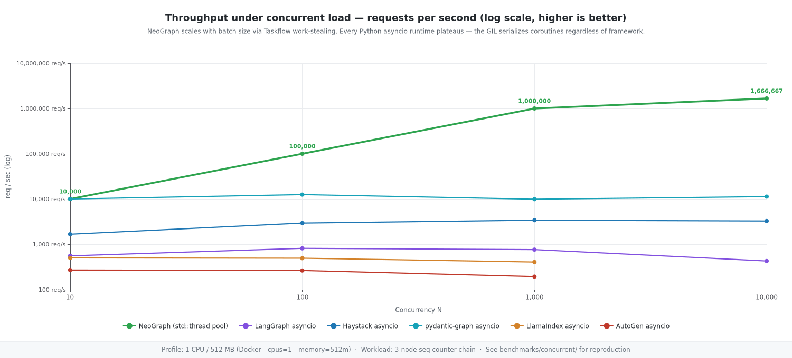
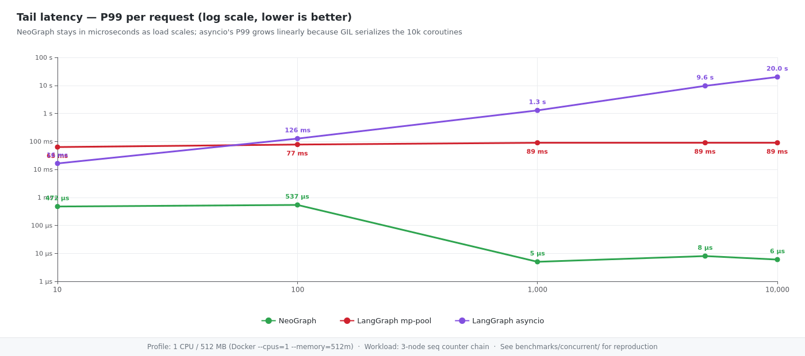
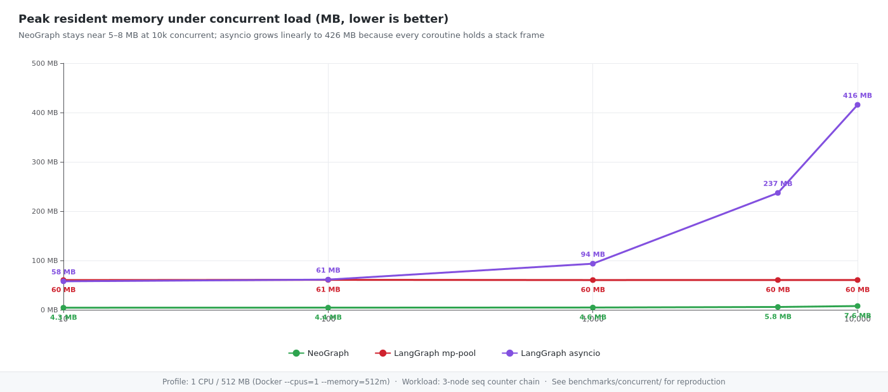

<!-- neograph-i18n: source=benchmarks/concurrent/CONCURRENT.md locale=ko source_sha256=1572d7641a5bfd945f5d48370e27d664b9fec200f2055153aa474492ed3b3ecc -->
# 동시 부하 벤치마크: NeoGraph와 Python의 과거 결과

**Languages:** [English](CONCURRENT.md) | [한국어](CONCURRENT.ko.md) | [日本語](CONCURRENT.ja.md) | [简体中文](CONCURRENT.zh-CN.md)

이 문서는 2026년 4월에 수행한 카운터 체인 비교를 그대로 보존합니다. 현재의 SchemaProvider SDK나 Python 바인딩으로는 다시 실행하지 않았습니다. “NeoGraph 3.0”은 기록된 측정 그룹의 이름표이며, 현재 패키지 버전이 아닙니다.

## 워크로드와 시간 측정

노드 세 개(`a → b → c`)가 overwrite 카운터 채널의 값을 차례로 증가시킵니다. 모델 호출, sleep, 네트워크 I/O, 체크포인트 저장소는 없습니다. 측정 매트릭스는 Docker 프로파일 1 CPU / 512 MB와 2 CPU / 1 GB에서 N ∈ {10, 100, 1000, 10000}건을 제출하며, 스왑은 메모리 한도와 같게 제한합니다.

NeoGraph는 호출자 쪽에 `max(hardware_concurrency(), 1)` 크기의 `asio::thread_pool`을 둡니다. 요청별 시간은 워커 안에서 재기 시작하므로 P50/P99에는 호출자 큐에서 기다린 시간이 들어 있지 않습니다. `total_wall_ms`에는 제출 시간과 전체 요청 묶음이 모두 처리되기까지의 시간이 포함됩니다. 마이크로초 단위의 P99를 종단 간 서버 SLO와 곧바로 비교하면 안 됩니다.

과거 Python 쪽 비교 대상은 LangGraph 1.1.9, Haystack 2.27.0, pydantic-graph 1.84.1, LlamaIndex Workflow 0.14.20, AutoGen GraphFlow 0.7.5이며, 각각 asyncio 모드와 multiprocessing 모드로 실행했습니다. 이 버전은 당시 측정 그룹의 것이고, 현재 Docker가 의존성을 해석한 결과가 아닙니다.

## 과거 결과: 1 CPU / 512 MB

차트와 표에는 2026-04-22에 보고된 NeoGraph 결과와 2026-04-19의 Python 결과가 그대로 들어 있습니다. N=10,000 표는 엔진만 측정한 것이며 provider 전송이나 추론은 포함하지 않습니다. 측정되지 않은 지표는 빈 값으로 남겨 두었습니다.







| N | 엔진 + 모드 | 경과 시간 | P50 | P99 | 최대 RSS | 성공 / 오류 |
|---|---------------|------|-----|-----|----------|---------|
| 10,000 | NeoGraph 3.0 (과거 이름표) | 52 ms | 4 µs | 7 µs | 5.5 MB | 10000 / 0 |
| 10,000 | LangGraph asyncio | 23.4 s | 20.2 s | 23.0 s | 416.2 MB | 10000 / 0 |
| 10,000 | LangGraph mp-pool-7 | 8.0 s | 737 µs | 88.4 ms | 60.3 MB | 10000 / 0 |
| 10,000 | Haystack asyncio | 3.1 s | 1.7 s | 2.9 s | 130.7 MB | 10000 / 0 |
| 10,000 | Haystack mp-pool-7 | 2.9 s | 167 µs | 84.7 ms | 68.1 MB | 10000 / 0 |
| 10,000 | pydantic-graph asyncio | 886 ms | 71 µs | 158 µs | 42.6 MB | 10000 / 0 |
| 10,000 | pydantic-graph mp-pool-7 | 2.8 s | 253 µs | 83.8 ms | 36.7 MB | 10000 / 0 |
| 10,000 | LlamaIndex asyncio | OOM으로 종료 | — | — | — | — |
| 10,000 | LlamaIndex mp-pool-7 | 6.6 s | — | — | 102.5 MB | 0 / 10000 |
| 10,000 | AutoGen asyncio | OOM으로 종료 | — | — | — | — |
| 10,000 | AutoGen mp-pool-7 | 46.8 s | 4.6 ms | 97.1 ms | 49.1 MB | 10000 / 0 |

전체 매트릭스는 [`results.jsonl`](results.jsonl)에 보관되어 있습니다. LlamaIndex와 AutoGen의 asyncio 칸은 OOM 종료로 분류되었고, 이 행에서 LlamaIndex의 multiprocessing 호출은 모두 실패했습니다. 이 관찰만으로 각 프레임워크의 일반적인 한계를 단정하거나 모든 실패의 원인을 진단할 수는 없습니다.

## 해석의 한계

GIL이 켜진 CPython은 Python 바이트코드를 직렬로 실행하지만, 이벤트 루프 스케줄링, 프레임워크의 작업, 프로세스 간 직렬화, 워커 수도 처리량에 영향을 줍니다. 이 벤치마크로는 어느 한 원인을 따로 가려낼 수 없고, asyncio에 일반적인 상한이 있다고 단정할 수도 없으며, free-threaded Python의 성능을 예측할 수도 없습니다.

Docker의 CPU 할당량이 `hardware_concurrency()`에 보이는 코어 수를 바꾸지 않을 수 있습니다. 호출자 풀 크기와 호스트 토폴로지를 기록해 두어야 합니다. 최대 RSS는 Linux의 `/proc/self/status`에서 가져오며, 지원하지 않는 플랫폼에서 0이 나왔다면 측정할 수 없었다는 뜻입니다. multiprocessing의 메모리 수치는 각 러너가 집계하는 범위를 고려해서 읽어야 합니다. 이 표에서 256 MB 실험, 베어메탈 환경의 추정, 영속성 비교, 원격 LLM의 처리 용량 보장을 이끌어 낼 수는 없습니다.

## 현재 의존성과 재현 상태

`NEOGRAPH_BUILD_LLM=OFF`와 `NEOGRAPH_USE_LIBCURL=OFF`로 빌드해도 Core는 외부 `SchemaProvider::runtime`에 링크합니다. 설치된 SDK는 `CMAKE_PREFIX_PATH`로, 직접 받아 둔 체크아웃은 `NEOGRAPH_SCHEMAPROVIDER_SOURCE_DIR`로 지정합니다. 자세한 내용은 [빌드 가이드](../../README.md)를 참고하세요. SDK를 소스로 빌드하려면 C++20, 설정 생성에 쓰는 Python, libcurl 7.88 이상, OpenSSL Crypto가 필요합니다. SDK는 Linux/POSIX에서만 시험했으며, 예전 Docker 결과는 다른 플랫폼에 적용되지 않습니다.
NeoGraph `0.15.1` 레시피에는 알파 SDK `0.3.5`, 인터페이스 리비전/공유 라이브러리 세대 6과 이에 맞는 헤더/라이브러리가 필요합니다.

저장소에서 관리하는 NeoGraph Docker 이미지는 curl/OpenSSL 개발 의존성을 설치하고, `neograph::core`에 링크하는 비공개 CMake 소비자를 빌드합니다. 이 소비자는 SDK의 의존성 전체를 그대로 이어받습니다. SDK는 루트 CMake 정책에 따라 가져오므로, 패키지나 소스 체크아웃을 제공하지 않으면 네트워크 접근이 필요할 수 있습니다. 선택 사항인 NeoGraph 네트워크 모듈은 꺼져 있지만 SDK의 의존성은 남습니다. 매트릭스는 빌드하기 전에 출력 파일을 비우므로 새 경로를 지정해야 합니다. `status=ok`는 JSON을 추출했다는 뜻일 뿐이므로 `ok`, `err`, 종료 상태도 함께 확인해야 합니다.

```bash
# From the repository root. Docker builds use the root SDK acquisition policy.
docker build -t ng-concurrent -f benchmarks/concurrent/Dockerfile.neograph .
docker run --rm --cpus=1 --memory=512m --memory-swap=512m ng-concurrent 10000

# Full matrix; a NEW path preserves the archived results.jsonl.
bash benchmarks/concurrent/run_matrix.sh benchmarks/concurrent/results-new.jsonl

# Render the archived default results.jsonl, not the new output.
node benchmarks/render_concurrent.js
```

아래 JSON은 필드 형태만 보여 주는 예시이며, 추가로 측정한 결과가 아닙니다.

```json
{"engine":"neograph","mode":"threadpool","concurrency":10000,
 "total_wall_ms":6,"p50_us":2,"p95_us":3,"p99_us":6,
 "ok":10000,"err":0,"peak_rss_kb":7808}
```
