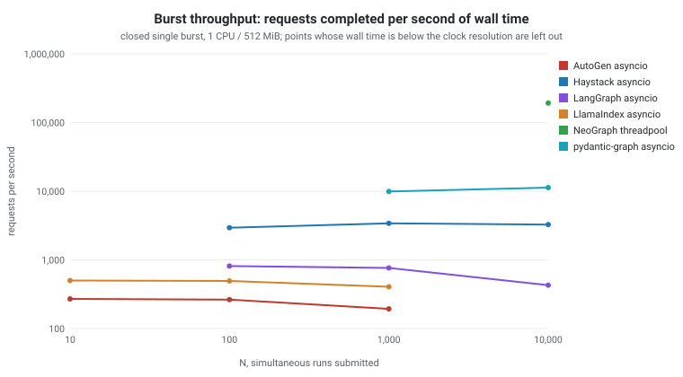
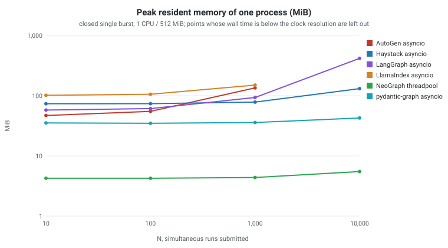

<!-- neograph-i18n: source=benchmarks/concurrent/CONCURRENT.md locale=ko source_sha256=c5618ac13a6472e43cc2a1c6dd605d9f9d85842c5b39a3d5f07d5592047cc3da -->
# 동시 부하 벤치마크: NeoGraph와 Python의 과거 결과

**Languages:** [English](CONCURRENT.md) | [한국어](CONCURRENT.ko.md) | [日本語](CONCURRENT.ja.md) | [简体中文](CONCURRENT.zh-CN.md)

이 문서는 2026년 4월에 수행한 카운터 체인 비교를, 기록된 데이터가 뒷받침하는 범위로 줄여서 보존합니다. 현재의 SchemaProvider SDK나 Python 바인딩으로는 다시 실행하지 않았고, 이 디렉터리의 하니스는 그 뒤에 수정되었습니다([철회와 수정](#withdrawn-and-corrected) 참조). 수정한 하니스로 다시 측정하는 일은 아직 남아 있습니다. “NeoGraph 3.0”은 기록된 측정 그룹의 이름표이며, 현재 패키지 버전이 아닙니다.

## 워크로드와 시간 측정

노드 세 개(`a → b → c`)가 overwrite 카운터 채널의 값을 차례로 증가시킵니다. 모델 호출, sleep, 네트워크 I/O, 체크포인트 저장소는 없습니다. 측정 매트릭스는 Docker 프로파일 1 CPU / 512 MB와 2 CPU / 1 GB에서 N ∈ {10, 100, 1000, 10000}건을 제출하며, 스왑은 메모리 한도와 같게 제한합니다.

NeoGraph는 호출자 쪽에 `max(hardware_concurrency(), 1)` 크기의 `asio::thread_pool`을 둡니다. 워크로드는 **닫힌 단일 버스트**입니다. N건을 한꺼번에 제출하고 모두 처리될 때까지 비우며, 시간에 따른 도착을 모델링하지 않습니다. `Wall`은 첫 제출부터 마지막 완료까지의 시간입니다. 기존 하니스는 이를 밀리초 정수로 기록했으므로 20 ms 미만의 NeoGraph 점은 어떤 차트나 비율에도 쓰지 않습니다. 기존 데이터의 요청별 열은 철회했습니다.

과거 Python 쪽 비교 대상은 LangGraph 1.1.9, Haystack 2.27.0, pydantic-graph 1.84.1, LlamaIndex Workflow 0.14.20, AutoGen GraphFlow 0.7.5이며, 각각 asyncio 모드와 multiprocessing 모드로 실행했습니다. 이 버전은 당시 측정 그룹의 것이고, 현재 Docker가 의존성을 해석한 결과가 아닙니다.

## 과거 결과: 1 CPU / 512 MB

아래의 표와 차트는 보관된 [`results.jsonl`](results.jsonl)에서 `scripts/render_bench_report.py`가 생성하며, wall 시간 열과 단일 프로세스 메모리 열만 남깁니다. NeoGraph 결과는 2026-04-22에, Python 결과는 2026-04-19에 보고되었습니다. N=10,000 표는 엔진만 측정한 것이며 provider 전송이나 추론은 포함하지 않습니다.





<!-- bench-record:begin concurrent_wall -->
| N | 엔진과 모드 | 닫힌 버스트의 벽시계 시간 | 최대 RSS, 프로세스 하나 (MiB) | 성공 / 오류 |
| ---: | :--- | ---: | ---: | ---: |
| 10,000 | NeoGraph threadpool | 52 ms | 5.5 | 10000 / 0 |
| 10,000 | pydantic-graph asyncio | 886 ms | 42.6 | 10000 / 0 |
| 10,000 | pydantic-graph mp-pool-7 | 2.8 s | 철회: 프로세스 트리를 합산하지 않음 | 10000 / 0 |
| 10,000 | Haystack mp-pool-7 | 2.9 s | 철회: 프로세스 트리를 합산하지 않음 | 10000 / 0 |
| 10,000 | Haystack asyncio | 3.1 s | 130.7 | 10000 / 0 |
| 10,000 | LangGraph mp-pool-7 | 8.0 s | 철회: 프로세스 트리를 합산하지 않음 | 10000 / 0 |
| 10,000 | LangGraph asyncio | 23.4 s | 416.2 | 10000 / 0 |
| 10,000 | AutoGen mp-pool-7 | 46.8 s | 철회: 프로세스 트리를 합산하지 않음 | 10000 / 0 |
| 10,000 | LlamaIndex asyncio | OOM으로 종료 | — | — |
| 10,000 | AutoGen asyncio | OOM으로 종료 | — | — |
<!-- bench-record:end concurrent_wall -->

전체 매트릭스는 [`results.jsonl`](results.jsonl)에 보관되어 있습니다. LlamaIndex와 AutoGen의 asyncio 칸은 OOM 종료로 분류되었으며, 호출마다 만든 인스턴스 1만 개가 동시에 512 MB에 들어가지 않았다는 뜻입니다. 이 관찰만으로 각 프레임워크의 일반적인 한계를 단정할 수는 없습니다. LangGraph asyncio 행은 일반 `def` 노드로 `ainvoke`를 호출하며 LangGraph는 이를 스레드 풀에서 실행합니다. `async def` 노드를 쓰면 다른 레짐입니다([엔진 오버헤드 가이드](../README.md) 참조).

<a id="withdrawn-and-corrected"></a>
## 철회와 수정

이 문서에서 철회한 항목과 각각의 이유입니다.

* **P50, P99 열과 지연 차트.** NeoGraph, multiprocessing 행, pydantic-graph(실행이 중단되지 않음)의 워커 안 서비스 시간을, 태스크를 만든 시점부터 잰 다른 asyncio 행의 시스템 체류 시간과 나란히 놓았으므로, 그 차이는 프레임워크가 얼마나 자주 양보하는지를 잰 것이지 얼마나 빠른지를 잰 것이 아닙니다.
* **LlamaIndex multiprocessing 행.** 하니스가 워크플로 핸들러를 실행 중인 이벤트 루프 밖에서 만들었기 때문에 모든 호출이 실패했습니다(10,000건 중 0건 완료). 6.6 s와 메모리 수치는 예외 처리에 든 값이었습니다.
* **multiprocessing 메모리 수치.** 하니스가 부모 프로세스만 세고 워커 프로세스는 세지 않았습니다.
* **N=10, N=100의 NeoGraph 처리량 점.** wall 시간을 밀리초 정수로 잘라 기록했고 렌더러가 이를 1 ms로 고정했으므로, 이 점들은 측정된 값이 아닙니다.

이 디렉터리의 하니스는 이제 모든 셀에 완료 수, 실패 수, 각 결과의 검증을 기록합니다. 실패가 있는 셀은 `status`가 `error`이고 백분위수가 없으며 종료 상태가 0이 아닙니다. 또한 하나의 공통 제출 시점부터 잰 서비스 시간과 응답 시간, 마이크로초 단위의 wall 시간, multiprocessing의 프로세스 트리 메모리 최대치도 기록합니다. Docker 매트릭스는 이 하니스로 다시 실행하지 않았습니다. 재측정은 아직 남아 있습니다. Docker 이미지는 이제 [`requirements-compare.txt`](../requirements-compare.txt)의 최신 릴리스에 고정되어 있으며, 이전의 LangGraph 고정 버전 1.1.7은 PyPI에서 yank되었습니다.

## 해석의 한계

GIL이 켜진 CPython은 Python 바이트코드를 직렬로 실행하지만, 이벤트 루프 스케줄링, 프레임워크의 작업, 프로세스 간 직렬화, 워커 수도 처리량에 영향을 줍니다. 이 벤치마크로는 어느 한 원인을 따로 가려낼 수 없고, asyncio에 일반적인 상한이 있다고 단정할 수도 없으며, free-threaded Python의 성능을 예측할 수도 없습니다.

Docker의 CPU 할당량이 `hardware_concurrency()`에 보이는 코어 수를 바꾸지 않을 수 있습니다. 호출자 풀 크기와 호스트 토폴로지를 기록해 두어야 합니다. 최대 RSS는 프로세스 하나의 Linux `/proc/self/status`에서 가져오며, 지원하지 않는 플랫폼에서 0이 나왔다면 측정할 수 없었다는 뜻입니다. NeoGraph는 풀 스레드당 최대 한 건만 유지하지만 Python asyncio 행은 N건 전부를 진행 중으로 두므로, 메모리 열은 같은 조건의 비교가 아닙니다. 이 표에서 256 MB 실험, 베어메탈 환경의 추정, 영속성 비교, 원격 LLM의 처리 용량 보장을 이끌어 낼 수는 없습니다.

## 현재 의존성과 재현 상태

`NEOGRAPH_BUILD_LLM=OFF`와 `NEOGRAPH_USE_LIBCURL=OFF`로 빌드해도 Core는 외부 `SchemaProvider::runtime`에 링크합니다. 설치된 SDK는 `CMAKE_PREFIX_PATH`로, 직접 받아 둔 체크아웃은 `NEOGRAPH_SCHEMAPROVIDER_SOURCE_DIR`로 지정합니다. 자세한 내용은 [빌드 가이드](../../README.md)를 참고하세요. SDK를 소스로 빌드하려면 C++20, 설정 생성에 쓰는 Python, libcurl 7.88 이상, OpenSSL Crypto가 필요합니다. SDK는 Linux/POSIX에서만 시험했으며, 예전 Docker 결과는 다른 플랫폼에 적용되지 않습니다.
NeoGraph `0.16.0` 레시피에는 알파 SDK `0.4.0`, 인터페이스 리비전/공유 라이브러리 세대 7과 이에 맞는 헤더/라이브러리가 필요합니다.

저장소에서 관리하는 NeoGraph Docker 이미지는 curl/OpenSSL 개발 의존성을 설치하고, `neograph::core`에 링크하는 비공개 CMake 소비자를 빌드합니다. 이 소비자는 SDK의 의존성 전체를 그대로 이어받습니다. SDK는 루트 CMake 정책에 따라 가져오므로, 패키지나 소스 체크아웃을 제공하지 않으면 네트워크 접근이 필요할 수 있습니다. 선택 사항인 NeoGraph 네트워크 모듈은 꺼져 있지만 SDK의 의존성은 남습니다. 매트릭스는 빌드하기 전에 출력 파일을 비우므로 새 경로를 지정해야 합니다. `status=ok`는 JSON을 추출했다는 뜻일 뿐이므로 `ok`, `err`, 종료 상태도 함께 확인해야 합니다.

```bash
# From the repository root. Docker builds use the root SDK acquisition policy.
docker build -t ng-concurrent -f benchmarks/concurrent/Dockerfile.neograph .
docker run --rm --cpus=1 --memory=512m --memory-swap=512m ng-concurrent 10000

# Full matrix; a NEW path preserves the archived results.jsonl.
bash benchmarks/concurrent/run_matrix.sh benchmarks/concurrent/results-new.jsonl

# Render the tables and charts from the archived results.jsonl, not from the new output.
python3 scripts/render_bench_report.py
```

아래 JSON은 필드 형태만 보여 주는 예시이며, 추가로 측정한 결과가 아닙니다.

```json
{"engine":"neograph","mode":"threadpool","concurrency":10000,
 "total_wall_ms":6,"p50_us":2,"p95_us":3,"p99_us":6,
 "ok":10000,"err":0,"peak_rss_kb":7808}
```
